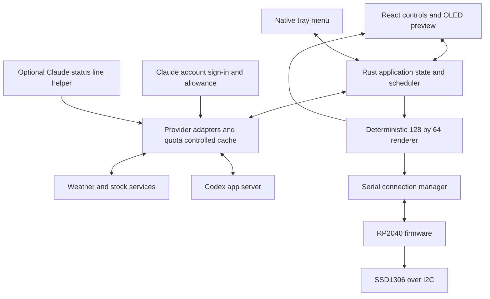

# Deskbot implementation specification

Specification date: October 11, 2026. Implementation status: the tray app, robot controls, offline renderer, and playlist are implemented and tested on macOS. Selected-device serial transport and firmware 1.0.2 drive replacement RP2040-Zero `505431651938581C`: complete known test text and readable app-driven sample widget cycling are confirmed by the user. The original damaged-panel diagnostic is archived. See [commissioning evidence and remaining checks](firmware/COMMISSIONING.md). Widget source editors, multiple instances, city search and units, free public stock quotes without API keys, the Codex account-window reader, a shared Claude account reader with browser sign-in, and an optional native Claude status-line bridge are implemented. Live weather, free stock output, Codex, and shared Claude account allowances are verified in the running macOS app. See [provider implementation evidence and deviations](PROVIDER_IMPLEMENTATION.md). Windows x64/ARM64 and Linux x86_64 packages now have native test and installer/startup evidence in [SPEC_COMPLETION.md](SPEC_COMPLETION.md); full tray, physical USB and live-account behavior on those platforms remain unverified. The requirements below describe the full target product, including later stages.

Deskbot is a small desktop companion for the green robot in the supplied photos. It lives in the computer's tray or menu bar. Opening its controls shows the robot's screen, a list of widgets, and controls for choosing their order and time on screen. The robot cycles through that selection while the control window is closed.

Build the desktop application with **Tauri 2, React, TypeScript, and a Rust background core**, and the RP2040 firmware with **Arduino-Pico C/C++**, using its bundled Pico SDK and USB CDC support. This matches the user's Arduino workflow; the implemented firmware uses the SDK's I²C calls and the independent panel diagnostic uses Arduino Wire and Adafruit SSD1306. Keep network access, credentials, scheduling, and normal rendering on the computer; keep display output and a disconnected face on the robot. MicroPython remains an optional diagnostics alternative.

## Product scope and first release

The first release supports one selected robot per computer, an offline preview, and five built-in widget types: Face, Weather, Stocks, Codex Usage, and Claude Usage. Allow multiple weather locations and stock symbols as separate widget instances. Include enable/disable, reorder, duration, configure, show now, pause/resume, next, brightness, and display sleep. Persist settings locally.

The normal operating model is a computer connected to the robot with a USB data cable. The RP2040-Zero has USB and I²C but no onboard network radio. A power bank can run the firmware's face; live weather, stocks, and account updates require the host. The SSD1306 is a monochrome display: its blue light comes from the physical panel, so software cannot make it green or show multicolor graphics. [Waveshare hardware](https://www.waveshare.com/wiki/RP2040-Zero), [SSD1306 controller datasheet](https://cdn-shop.adafruit.com/datasheets/SSD1306.pdf).

Keep third-party executable plugins, multiple simultaneous robots, wireless hardware, cloud accounts for Deskbot itself, and unattended firmware updates outside version 1. The widget interface must allow new built-in widgets without changing the USB protocol.

## Desktop presence on each platform

| Platform | User-facing name | Required behavior |
| --- | --- | --- |
| Windows | System tray or notification area, beside the taskbar clock | Left click opens the compact controls; right click opens the native menu. Account for icons placed in the overflow area. Closing controls leaves the resident app running. |
| macOS | Menu bar status item | Click opens the compact controls near the icon. Use a monochrome template robot-head icon that works in light and dark appearance. Run as an accessory app with no persistent Dock icon. Reopening from Applications reveals controls. |
| KDE Plasma and compatible Linux desktops | System tray or status area in the panel | Provide a native indicator menu with Open Deskbot. Do not require a particular click gesture or precise popup anchoring. |
| GNOME without indicator support | Application window and launcher fallback | Keep controls reachable from the application launcher. Offer indicator-extension guidance. Do not silently hide the only window behind a nonexistent tray. |

Tauri supports tray menus, but its documented Linux tray mouse events are unavailable. Linux therefore uses **Open Deskbot from the indicator menu**, with a normal compact window as the reliable fallback. GNOME has an AppIndicator/KStatusNotifierItem extension; KDE provides a system tray. Menu position, mouse behavior, and title-bar decoration remain desktop-dependent. [Tauri tray API](https://v2.tauri.app/learn/system-tray/), [GNOME extension](https://extensions.gnome.org/extension/615/appindicator-support/), [KDE handbook](https://docs.kde.org/trunk_kf6/en/plasma-desktop/plasma-desktop/plasma-desktop.pdf).

Implement one application instance. A second launch focuses the existing controls and never takes a second lock on the serial port. The tray menu contains Open Deskbot, Pause/Resume cycle, Next widget, Show face, Display off/on, Settings, and Quit. The menu remains native and follows OS styling; the branded controls live in the app window. Register Start at login only when the user enables it. A supported autostart plugin exists, but its behavior must be verified on each platform. [Tauri autostart](https://v2.tauri.app/plugin/autostart/).

If no usable Linux indicator host is detected on the session bus, use window mode. If detection is uncertain, default to window mode and let the user explicitly choose background mode. Preserve a launcher entry in every mode. On macOS, a hidden menu bar item must likewise be recoverable by relaunching the app. [Apple status bar](https://developer.apple.com/documentation/appkit/nsstatusbar).

## Appearance and interaction design

Use the assembled robot photo, IMG_0308.HEIC, as the primary design reference: a rounded green head, short antenna with a ball tip, inset black screen, two upright blue outlined eyes, and a small curved smile. IMG_0299.HEIC is a hardware reference. Neither photo establishes a wiring assignment or contains software requirements.

The following colors are proposed design tokens, chosen to evoke the photograph rather than claimed as calibrated samples:

| Token | Value | Use |
| --- | --- | --- |
| Robot green | `#14A77A` | Head frame, identity accent, selected controls |
| Deep green | `#087458` | Dark edge of the head and readable green text in light mode |
| Screen black | `#06100E` | OLED preview |
| OLED blue | `#38BDF8` | Lit pixels in the simulated blue panel |
| Light surface | `#F3F8F5` | Default light app background |
| Dark surface | `#14201C` | Dark app background |
| Primary ink | `#172D25` / `#EAF6EF` | Light/dark text |

Use a system sans-serif font, 14 px normal control text, restrained 12 px secondary labels, rounded controls, and generous hit targets. Reserve pixel lettering for the OLED preview. Use 20–24 px rounding on the robot head and 10–12 px on control groups. Make the robot visually recognizable without making every control look like a toy. Use native focus behavior, accessible labels, keyboard alternatives to dragging, and text alongside connection and error colors. Validate normal text contrast at 4.5:1. Respect reduced motion.

### Compact controls

Target a 420 px wide, approximately 620 px tall panel, constrained to the available monitor work area. Allow vertical scrolling at small desktop sizes and at enlarged text scales. Position near the tray on Windows and macOS where supported; clamp to the work area across multiple monitors and scale factors. On Linux, use the last valid window position or center on the active monitor.

The panel has four parts, in this order:

1. A small Deskbot wordmark and connection state: Connected, Preview only, Reconnecting, or Setup needed.
2. A green robot head with antenna and a 2:1 black screen. Render the exact 128×64 output buffer at an integer scale, normally 2×. Beside or below it, name the current widget and show its remaining display time. Label sample data as Demo.
3. Play/Pause and Next, followed by the cycle list. Each row has an enable switch, widget name, short setting summary, duration, and Configure action. Reordering works through a drag handle and accessible Move up/Move down commands.
4. Add widget, brightness, and a Settings link. Show the resulting full cycle length below the list.

Selecting a row previews it in the app without changing the physical robot. **Show now** sends that widget to the robot for one complete dwell period, then restores the previous playback mode and position. **Pin** holds the selected widget until Resume cycle; it does not stop its data refresh. Closing the panel leaves these choices intact. Each editor has Apply and Cancel, and invalid edits never replace the active configuration.

### Settings and setup

Provide separate sections for Robot, Data sources, Display, and App. Robot settings show model, firmware version, connection health, and identification. Data sources explain authentication, refresh timing, attribution, and unavailable fields. Display settings include brightness, orientation, and quiet hours. App settings include appearance, start at login, recovery/window mode, and diagnostics export.

The first launch offers Connect robot or Try preview. Connection setup identifies a compatible device, verifies a handshake, and displays a test face before declaring success. If existing firmware is unknown, show the guided firmware installation step and preserve a recoverable copy where the board and tools permit. Do not claim flashing is a backup. The first usable playlist contains Face; all data widgets remain opt-in until configured.

## Widget contract and display layouts

A widget is a configured instance with a stable ID, a type, a name, enabled state, duration, settings, and an optional credential reference. Its provider produces typed data with a source timestamp and freshness state. Its renderer produces a 1,024-byte monochrome buffer and a readable accessibility summary. Rendering must not fetch data or read secrets.

| Widget | Controls | OLED layout | Proposed default |
| --- | --- | --- | --- |
| Face | Happy, neutral, sleepy, surprised; blink on/off; animation speed | Two eyes and a small mouth, based on the photo | 12 seconds; animation capped at 12 fps |
| Weather | Location search, °C/°F, current or high/low layout | Short place name, weather symbol, large temperature, compact condition or high/low | 10 seconds; refresh every 15 minutes |
| Stocks | Symbol with exchange suffix, name; currency from provider | Symbol, price, quote currency/date; change where verified | 8 seconds per instance; refresh every 15 minutes |
| Codex Usage | Account connection, returned limit bucket, window selection | CODEX, named window, percent left, bar, reset countdown | 8 seconds; refresh at most every 5 minutes plus user refresh |
| Claude Usage | Shared account sign-in, five-hour/seven-day window; optional local Code report | CLAUDE, window, percent left, bar, snapshot age/reset countdown | 8 seconds; account refresh every 5 minutes |

Use a bundled bitmap font with predictable glyph widths. A 6×8 character cell fits about 21 characters across the full display; reserve margins and a footer. Normal text stays inside x=2…125 and y=2…61. Large values use dedicated digit glyphs; the renderer measures actual text before placement. For long names, allow a short display label and deterministic ellipsis; never run arbitrary Unicode through a font that cannot render it. Include a degree glyph, minus sign, percentages, currency letters, and an ASCII fallback. Never clip a price into a different apparent number.

Prototype each layout at physical 0.96-inch viewing size. A usable large number and short footer take precedence over a full location name. Render stale/error metadata visibly on the robot when a cached value is displayed. Prefer page cuts or a short nonflashing transition. Do not use a full-screen flash between widgets.

## Cycle engine behavior

The Rust core owns the scheduler and continues with no webview open. It uses monotonic time for durations and wall time for quiet hours and provider timestamps. Screen dwell and network refresh are independent: a widget appearing every minute must not fetch its provider every minute.

- Duration is 3–120 seconds per instance, defaulted by widget type. The playlist repeats in user order; disabled or unconfigured instances are omitted. At most 30 instances in version 1.
- Pause freezes the current card and remaining dwell; data may still refresh. Resume continues the remaining dwell. Pin holds a widget without a dwell countdown. Next selects the next eligible widget and gives it a full dwell; in Pause it remains paused, and in Pin it remains pinned.
- Show now temporarily replaces the current card for its full dwell, then returns to the stored cycle position and remaining dwell. If invoked while paused or pinned, restore that mode and its prior selection when the temporary display expires. If the stored widget was removed or disabled, choose the next eligible widget in the updated order with a full dwell.
- Changes commit atomically. Disabling/removing the current widget immediately selects the next eligible entry. Reordering preserves the current widget and elapsed dwell. Changing its duration preserves elapsed time and advances immediately if the new duration has already elapsed.
- A widget without usable data is skipped; show its reason in the panel. A cached but expired quote is never shown as current. If no widget is eligible, show the built-in face. If the user disables every widget, show a face with an explicit empty-cycle explanation in the app.
- Quiet hours suspend the playlist and switch the panel off by default. They support overnight ranges and the computer's time zone. Re-evaluate after sleep, time-zone changes, and daylight-saving transitions. Do not prevent the computer from sleeping. On wake, reconnect, refresh stale providers within quota, and restart the current eligible widget with a full dwell.
- Manual Display off wins until Display on; quiet hours then still apply. Provide a clearly labeled temporary quiet-hours override for 15 minutes. Disconnect or host failure always yields firmware fallback behavior.

Treat precedence as: device/display fault → manual off → quiet hours unless overridden → Show now → Pin → Pause → normal cycle. The panel must name the controlling state.

## Data integrations

### Shared provider behavior

Every normalized result contains `sourceId`, `scopeId`, `observedAt`, `fetchedAt`, `expiresAt`, `state`, and typed values. State is one of fresh, stale, unavailable, authentication required, rate limited, or invalid configuration. Unknown values are null. A zero is a real measurement, never a substitute for unavailable data.

Run requests in the background with a 10-second timeout, cancellation, and one in-flight request per provider/cache key. Retry transient failures after 30 seconds, 2 minutes, and 10 minutes with jitter; honor a longer Retry-After. Authentication and invalid-configuration failures wait for user action. Deduplicate identical queries across widgets. Enforce a quota budget shared by all requests using the same provider account, including manual refreshes. Normalize provider-level errors even when HTTP status is 200. Reject oversized responses and invalid timestamps or numbers.

Do not contact providers for disabled widgets. When the robot is disconnected and no preview is open, suspend routine network polling after a short grace period; refresh on reconnection. Persist only the minimum cache needed for startup, honoring provider retention terms. Weather becomes stale at 30 minutes and unusable at 2 hours by default. Usage snapshots become stale after 10 minutes and unusable for percent-left display after 1 hour or at their reset time, whichever occurs first. These are product policies, not provider guarantees.

### Weather

Use Open-Meteo for the personal prototype. Its forecast API accepts coordinates and provides current temperature, weather codes, and daily high/low data. Its free hosted service is restricted to non-commercial use with request limits and attribution requirements; a commercial Deskbot release must use an appropriate service plan. [Weather API](https://open-meteo.com/en/docs), [service terms](https://open-meteo.com/en/terms).

Proposed request fields: `current=temperature_2m,weather_code,is_day`, `daily=temperature_2m_max,temperature_2m_min`, `timezone=auto`, and the selected temperature unit. Use the provider's geocoding service when the user searches for a city, then save the selected coordinates and time zone. Distinguish identically named cities by region/country. Do not infer location from the host's IP. Label the data as model-based conditions in provider details and retain the model timestamp. Include Open-Meteo attribution and the relevant license link in the widget details/About credits.

### Stocks

User requirement: quotes must be free and require no API key, account registration, or paid subscription. Use public Yahoo Finance quotes for the personal prototype. Setup consists of entering a Yahoo symbol, including its exchange suffix where applicable, and saving the widget. Currency must come from provider metadata, never a guessed user label. Add a separate instance for each symbol.

The implemented compatibility adapter requests public chart metadata and validates the returned symbol, finite price, quote timestamp, and currency. It shows the last regular-session price with a quote date; it does not imply after-hours coverage or guaranteed real-time data. Refresh at most every 15 minutes and share cached results for identical configurations. Show quote age in the desktop details. A fetched weekend quote can be current as a source response while retaining Friday's displayed quote date. Preserve pence units: Yahoo GBp is rendered as GBX, not GBP. [Yahoo exchange/delay information](https://help.yahoo.com/kb/finance/article-exchanges-data-delays-sln2310.html).

Bound network calls and response size. Fail safely for missing metadata, mismatched symbols, invalid times, and quotes older than seven days. After a failed refresh, use an eligible previous quote with a stale label until expiry; otherwise skip the widget. Do not display missing data as zero. Keep source attribution and the delay disclaimer visible in configuration/details.

The public chart endpoint is a compatibility integration with no service guarantee. It can change or rate-limit requests. Commercial redistribution, provider terms, exchange licensing, and any alternate source require separate release review. This prototype provides no trading or real-time entitlement guarantee.

### Codex usage

The documented app server provides `account/rateLimits/read` and `account/rateLimits/updated`. Initialize the connection with `initialize` and `initialized`; prefer `rateLimitsByLimitId`, falling back to `rateLimits`. Windows provide `usedPercent`, `windowDurationMins`, and `resetsAt`. These describe allowance windows, not a count of remaining tokens. [Official app-server documentation](https://learn.chatgpt.com/docs/app-server).

Use a supported, user-installed Codex CLI as a managed local child process communicating over stdio. Identify Deskbot in the handshake, check its protocol compatibility, and use the CLI's supported sign-in flow when needed. The read-only adapter must not start model turns. Keep a strict method allowlist for initialization, account identity, authentication setup, and rate-limit reads. Do not copy account credentials into Deskbot files or assume that the Codex desktop application's private bridge is available to a standalone app.

Normalize each returned window separately. Compute `remainingPercent = clamp(100 - usedPercent, 0, 100)` only from a finite returned number. Generate the window label from its supplied duration rather than assuming a 5-hour/weekly pair. Require the user to choose among distinct named buckets; never sum their percentages. Keep snapshots bound to the returned account identity and clear them on account changes. At reset, show Updating until a fresh result arrives. API-key-only setups may have no subscription allowance; display Unavailable with the reason. Preserve raw precision and round only for display.

### Claude usage

Default to the shared Claude account allowance, including desktop and web use. Claude documents that claude.ai, Claude Code, and Claude Desktop count toward the same account limits. Show remaining allowance percentages for the selected five-hour or seven-day window; these are not remaining token counts. [Claude usage limits](https://support.claude.com/en/articles/11647753-how-do-usage-and-length-limits-work).

The installed Claude Code client provides account sign-in. Deskbot's **Connect Claude account** control starts `claude auth login --claudeai`, opens the browser, and waits for completion with a bounded ten-minute deadline. It performs no model turn. Read the existing local sign-in using its exact credential-store account on macOS or the client's credential file on other platforms. Never put credentials in Deskbot settings, logs, screenshots, or exported evidence.

The account reader uses the Claude client compatibility endpoint `/api/oauth/usage` with its existing OAuth session. This endpoint is not a documented public allowance API and may change. Fetch at most every five minutes; validate each window's finite utilization and future reset timestamp independently. Missing, expired, rejected, or unavailable data must not become a fabricated zero. Reconnect expired/rejected sign-ins through the editor. Bind runtime cards to the credential scope and invalidate them after reconnect. Windows/Linux credential and login behavior still require native acceptance.

Retain **Claude Code status-line report** as an optional local source. The documented status-line JSON can include five-hour/seven-day usage after an eligible session response, with fields independently absent. The native helper stores only allowlisted allowance fields, a local session identifier, and receipt time. It makes no network request and works while Deskbot is closed. Preserve and chain an existing status-line command, back up its setting, and offer restoration. Cap input at 64 KiB, write snapshots atomically per session, and label their receipt age. No fresh report means waiting/stale. Never add percentages from different sessions or profiles. Native Windows does not automatically cover WSL. [Status-line documentation](https://code.claude.com/docs/en/statusline).

## Application architecture and framework decision

| Option | Fit and tradeoff | Decision |
| --- | --- | --- |
| Tauri 2 plus web UI and Rust | Uses the platform webview, supports tray interfaces, permits a native background core, and fits a custom robot theme; platform webview and Linux indicator differences require testing | Recommended |
| Electron plus TypeScript | Mature tray support and one browser engine; bundles a larger runtime and introduces native serial-module packaging work | Viable fallback if Tauri platform testing reveals a blocker |
| Qt with C++ or Python | Mature tray and desktop integration; custom design is possible but adds a separate UI approach and distribution/licensing decisions | Viable, not selected for this project |
| Browser/PWA only | Hardware and resident background behavior vary by browser; insufficient control over native tray lifecycle | Do not use for the resident application |

These are engineering choices, not measured performance comparisons. [Tauri architecture](https://v2.tauri.app/concept/architecture/), [Electron tray behavior](https://www.electronjs.org/docs/latest/api/tray), [Qt tray support](https://doc.qt.io/qt-6/qsystemtrayicon.html).

The renderer, scheduler, provider normalization, and protocol encoder live in a Rust core crate with no webview dependency. Use a Tokio runtime for provider work and a dedicated serial worker for blocking serial I/O; `serialport` provides cross-platform enumeration and access. The controls receive snapshots and frame bytes through narrowly scoped Tauri commands/events. Hide or destroy the webview when idle; timers, providers, and the USB connection must continue. [Serial library](https://docs.rs/serialport/latest/serialport/).

Proposed modules: `apps/desktop` for the React shell and Tauri entry point; `crates/deskbot-core` for state/rendering/scheduling; `crates/providers` for integrations; `crates/protocol` for framing; `crates/bridge` for the Claude helper; `firmware` for Pico SDK sources; `assets/oled` for bitmap fonts/faces; `tests/fixtures` for recorded sanitized provider responses and independent frame expectations.

Store versioned settings as an atomically replaced JSON file with a last-known-good backup. Store no tokens in widget settings. Use OS application-data locations, not a working-directory-relative path. Account secrets belong in the platform credential store through a maintained adapter such as the current keyring ecosystem; if a Linux secret service is unavailable or locked, offer session-only storage and explain that state. [Credential-store documentation](https://docs.rs/keyring/latest/keyring/).

Settings schema version 1 includes `widgets[]`, `playlistOrder[]`, `selectedDeviceId`, `brightness`, `orientation`, `quietHours`, `appearance`, `launchAtLogin`, `providerProfiles`, and `windowMode`. Each widget has `id`, `kind`, `name`, `enabled`, `dwellMs`, `configVersion`, `config`, and `credentialRef`. Configuration migrations must preserve the last readable version and reject unknown future schemas without overwriting them.

## USB connection and firmware

Use USB CDC ACM for the first release. Correctly described CDC devices can use Windows' built-in Usbser driver. On Linux, serial permissions may need a device-specific udev rule or membership in the owning serial group. The app must diagnose access denied, port busy, bootloader present, unsupported firmware, and missing data cable as different possibilities. Do not fix permissions with world-writable device nodes or run the whole app as root. [Microsoft CDC driver](https://learn.microsoft.com/en-us/windows-hardware/drivers/usbcon/usb-driver-installation-based-on-compatible-ids), [Linux serial access](https://support.arduino.cc/hc/en-us/articles/360016495679-Fix-port-access-on-Linux).

Select devices using an approved USB descriptor/profile and a successful Deskbot handshake. Persist the firmware-reported board ID, not a COM port number. Re-enumerate on reconnect; serial paths can change. Do not send discovery commands indiscriminately to other serial devices. Reserve an appropriate USB VID/PID for distribution; do not invent or appropriate another vendor's identity. Bootloader identification is separate from Deskbot runtime identification.

The firmware uses Pico SDK I²C and TinyUSB CDC with a cooperative loop, bounded parser buffers, a watchdog, and timeouts for display writes. Keep diagnostics inside protocol messages or a separate debug interface. A blocked OLED must not block USB health reporting. Use a verified board profile for SDA, SCL, I²C controller, address, dimensions, and orientation. An unconfigured firmware remains discoverable over USB without probing arbitrary GPIOs. [Pico SDK](https://www.raspberrypi.com/documentation/microcontrollers/c_sdk.html), [TinyUSB](https://docs.tinyusb.org/en/latest/).

Use 400 kHz I²C after verifying the actual wiring, with a 100 kHz compatibility mode. The SSD1306 timing table specifies a 2.5 µs minimum bus clock cycle. A 1,024-byte transfer requires roughly 9,216 bus clocks before command overhead, approximately 23 ms at 400 kHz or 92 ms at 100 kHz. Thus 12 fps at 400 kHz and 5 fps at 100 kHz are initial caps to measure on hardware, not claims of achieved frame rate. [Controller timing table](https://cdn-shop.adafruit.com/datasheets/SSD1306.pdf).

The host supplies complete frames for all normal widgets, including animation. Static widgets send only when content changes. Firmware contains the same generated face assets for boot/disconnect fallback, avoiding dependency on the host for a friendly face. Keep transient frames in RAM. Write flash only when confirmed device configuration changes, never for every frame. Double-buffering prevents partial protocol data from becoming a display frame, though it does not guarantee the OLED's internal scan is tear-free.

### Version 1 wire protocol

Use COBS framing with a zero delimiter. The decoded packet is: magic `DB` (2 bytes), major version (u8), message type (u8), session ID (u32), sequence (u32), payload length (u16), flags (u16), payload, and CRC-32/ISO-HDLC (u32). Integers are little-endian. CRC covers the 16-byte header and payload; parameters are polynomial `0x04C11DB7`, reflected input/output, initial/final XOR `0xFFFFFFFF`. The standard `123456789` check value is `0xCBF43926`.

Maximum payload is 1,024 bytes, maximum decoded packet 1,044 bytes, and receive storage 1,100 bytes. Reject bad CRC, size, version, or unknown mandatory flags. An overlong or incomplete frame is discarded through the next delimiter; a 500 ms incomplete-message timeout resets assembly. Payloads are either bounded UTF-8 JSON for control messages or exactly 1,024 raw bytes for display frames. Never deserialize host data into executable instructions.

| Type | Name | Semantics |
| --- | --- | --- |
| `0x01` | HELLO | Host sends a new nonzero session ID and supported version; device responds with HELLO_ACK using the same ID/sequence |
| `0x02` | HELLO_ACK | Reports firmware version, board ID, display geometry, configured profile, maximum fps, and display health |
| `0x10` | FRAME | Complete page-packed bitmap; bit y%8 in byte `(y/8)*128+x` controls pixel x,y |
| `0x11` | DISPLAY | Set on/off, contrast 0–255, and orientation 0 or 180 degrees; applies until changed |
| `0x12` | FALLBACK | Request the built-in face and its configured idle behavior |
| `0x20` | PING | Keepalive and health request; no display change |
| `0x21` | ACK | Same session/sequence as request; contains applied state and display health |
| `0x22` | ERROR | Same session/sequence; stable error code and bounded diagnostic message |

Only HELLO is accepted outside a session. Start sequences at 1 and reconnect before wraparound. Use one in-flight command and keep only the newest unsent frame. A 500 ms ACK timeout retries once with the same sequence; after another timeout reconnect. Duplicate commands return their previous result without applying again. An ACK for FRAME means validation and I²C transmission completed; it does not prove that a human saw the correct pixels. A DISPLAY error remains visible in the host even when USB is healthy.

Send PING every 2 seconds when no other command has been acknowledged. After 10 seconds without a valid host command, firmware switches from transient content to the face, dims after 60 seconds, and blanks after 10 minutes. Manual display-off remains off across a lost session; an explicit host command or reboot restores it. USB suspend switches the panel off while bus-powered, then follows reconnect/host policy on resume. If the computer removes USB power, the robot turns off completely. Reconnect with bounded backoff of 1, 2, 5, then 10 seconds.

### Hardware commissioning

The supplied assembly photo shows OLED pads GND, VDD, SCK, SDA, but the controller-side GPIO numbers are hidden. Confirm the exact RP2040-Zero variant, power wiring, and module pull-up voltage before a production profile is enabled. The SSD1306 controller datasheet does not establish the safe supply voltage of every AITRIP module. Confirm `0x3C` or `0x3D` on the actual wired bus, orientation, and display dimensions. Preserve existing firmware when possible before replacement. [RP2040-Zero details](https://www.waveshare.com/wiki/RP2040-Zero), [MicroPython board flashing](https://micropython.org/download/WAVESHARE_RP2040_ZERO/).

The commissioning evidence is a saved board profile, wire-to-pin photograph or traced map, successful USB handshake, observed face, and observed test text. With an I²C failure, firmware reports the fault over USB and keeps running. Firmware recovery uses physical BOOTSEL and a board-specific UF2; automatic firmware updates are deferred.

## Packaging and resource targets

Proposed release targets are Windows 11 x64 and ARM64, macOS 13 or later on Apple Silicon and Intel, and Linux x86_64 on Ubuntu 24.04 LTS and Fedora 43, covering GNOME and KDE where applicable. These are intended test targets, not verified support claims. Add Linux ARM64 only after a native build and hardware test. Reassess minimum versions against the exact pinned dependencies before release.

Use signed Windows installers, signed and notarized macOS app bundles/DMGs, and native Linux `.deb`/`.rpm` packages with declared webview/indicator dependencies. AppImage is optional after real-machine validation; do not treat it as proof of universal Linux compatibility. Defer Flatpak/Snap until USB permissions, child processes, and tray behavior have their own integration tests. Windows needs WebView2 at runtime; Linux needs the supported WebKitGTK stack. [Tauri prerequisites](https://v2.tauri.app/start/prerequisites/), [distribution](https://v2.tauri.app/distribute/), [macOS signing](https://v2.tauri.app/distribute/sign/macos/).

Do not make ordinary users install Rust, Node, Python, or an IDE. Codex and Claude Code are optional dependencies only for their respective integrations. Pin dependency versions and preserve lockfiles. Use platform-native build jobs when release work is authorized. The eventual updater must verify signed artifacts; keep firmware installation separate. [Tauri updater](https://v2.tauri.app/plugin/updater/).

Initial engineering targets: controls visible within 500 ms from a warm tray click; static-widget resident CPU below 1% averaged over 5 minutes on the declared reference machine; no continuous render loop for static content; resident memory below 100 MB with controls closed, excluding an optional Codex child process, whose usage must be reported separately; reconnect and restore the current card within 5 seconds after OS enumeration; no growing memory trend during a 24-hour run. Treat these as measured acceptance targets to tune after the platform prototype, not marketing promises.

## Privacy and diagnostics

Keep API calls and account integrations in the Rust/helper processes. Load only bundled UI assets, use a restrictive content security policy, and expose narrow typed commands to the webview. Escape provider strings. Logs exclude credentials, URL query secrets, prompts, transcripts, and account email. Diagnostics export includes versions, redacted device identity, connection errors, timings, and provider status; the user previews the export before sharing. No telemetry or crash uploading by default.

The robot receives pixels and display commands only. Provider authentication and locations do not enter its persistent flash. Treat received serial packets and bridge files as untrusted input, with fixed limits and schema validation. Retain configuration backups, provide reset controls scoped to Deskbot, and preserve other apps' settings when removing integrations.

## Acceptance tests

Each test records known input, integrated action, expected outcome, actual outcome, and pass/fail evidence. Build success alone does not satisfy these contracts. Run hardware-dependent cases on each supported OS/architecture before claiming support.

| ID | Scenario and independent expected result | Required evidence |
| --- | --- | --- |
| A01 | Enable Face 3s, Weather 4s, Stock 5s. Observe precisely that sequence for two cycles while the controls are closed | Physical screen recording with timestamps; scheduler trace as supporting evidence |
| A02 | Disable Weather mid-display; Stock becomes current. Reorder while Face is current; Face completes its existing dwell | UI and physical output, with explicit expected sequence |
| A03 | Pause, Next, Pin, Show now, and Resume follow the specified state rules | Deterministic fake-clock state test plus one integrated UI/hardware run |
| A04 | Preview a row without Show now; physical robot stays on its cycle. Show now changes it and then resumes correctly | Side-by-side preview and robot observation |
| A05 | Unplug/replug; changed COM/path still selects the same board. Another serial device receives no Deskbot traffic | Enumeration log and device output |
| A06 | Kill host while displaying a stock. Face appears after 10s, dims, then blanks; stale price is removed | Physical timed observation; independently checked time bounds |
| A07 | Send truncated, corrupt, overlong, duplicate, and wrong-session packets, then a valid known frame | Protocol fixture tests and real-board recovery; no reset loop or wrong frame |
| A08 | Disconnect OLED while USB stays attached | Host says Display error; no success/connected-screen claim; USB remains responsive |
| A09 | Codex fixture reports 25% used in a 300-minute window | App and OLED show 75% left with the right window/reset; null and multiple buckets remain distinct |
| A10 | Claude fixture reports 42% used, then stops arriving and crosses reset time | 58% left initially; age/stale state appears; after reset percentage becomes unavailable without a fresh report |
| A11 | Existing Claude status line is installed, enabled through Deskbot, then removed | Original output/settings preserved; two simultaneous sessions cannot corrupt snapshots |
| A12 | Weather fixture with known temperature/unit/time; long accented location name | Correct conversion/layout, explicit glyph fallback, no overflow; physical readability review |
| A13 | Stock daily/delayed/live fixtures and provider quota error | Correct label/date/currency, no fabricated live status, quota respected even on repeated Refresh |
| A14 | GNOME without extension, GNOME with extension, KDE, Windows overflow, macOS hidden status item | User can open controls in every state; closing never loses the only recovery route |
| A15 | Sleep/wake, overnight quiet hours, DST change, manual off, and temporary override | Correct precedence; no wake prevention; clean reconnect and current data |
| A16 | Install, login startup, second launch, upgrade, uninstall on clean target systems | One resident process, settings preserved across upgrade, no developer tools required, startup entry removed on uninstall |
| A17 | Known corner pixels, checkerboard, and byte-boundary pattern sent in both orientations | Independent bitmap oracle plus photographs; host preview matches pixel positions |
| A18 | Keyboard-only and enlarged-text use; light/dark mode; small monitor work area | All actions reachable and labeled, contrast checked, no clipped controls |
| A19 | 24-hour cycle with intermittent network and USB failures | Memory/CPU trace, bounded queues, automatic recovery, no unexplained crash |

Provider tests begin with sanitized fixtures; live read-only checks then verify authentication and field mapping against the source app or provider response. Physical display review remains required after automated bitmap/protocol tests. A missing Windows or Linux machine leaves that target unverified.

## Implementation sequence

| Stage | Deliverable | Exit condition |
| --- | --- | --- |
| 1 | Tauri tray/window skeleton, green robot controls, offline renderer and playlist | Tray recovery demonstrated on Windows/macOS/Linux; cycle works with UI closed |
| 2 | Verified wiring profile, Pico firmware, USB handshake/frame protocol, fallback face | One controlled host input visibly produces the expected OLED image; reconnect and malformed-packet recovery pass |
| 3 | Widget editors, persistence, scheduler rules, brightness, quiet hours | A01–A04 and A15 pass with deterministic and physical evidence |
| 4 | Weather and free public stock adapters, caching, quote timestamps | Known fixtures and public provider responses agree with displayed output |
| 5 | Codex app-server adapter, shared Claude account reader, optional bridge | Correct allowance semantics and missing/stale behavior; existing CLI setup preserved |
| 6 | Native installers, signing, startup, accessibility, soak run | Target-by-target acceptance record; release labels match the systems actually verified |

Resolve hardware identity/wiring before stage 2. Validate source timestamps and delays without requiring a stock API key. Verify Codex CLI compatibility, shared Claude account fields, and optional status-line fields on the installed versions during stage 5. These are bounded integration checks; they do not prevent building the tray app, renderer, widget controls, or offline simulator.

## Reference index

All links are primary documentation or the relevant service's own terms. API capabilities, dependencies, and service plans should be rechecked when implementation is pinned.

| Area | Sources |
| --- | --- |
| Board and firmware | [Waveshare RP2040-Zero](https://www.waveshare.com/wiki/RP2040-Zero), [Pico SDK](https://www.raspberrypi.com/documentation/microcontrollers/c_sdk.html), [TinyUSB](https://docs.tinyusb.org/en/latest/), [MicroPython board page](https://micropython.org/download/WAVESHARE_RP2040_ZERO/) |
| OLED | [Solomon Systech SSD1306 datasheet hosted by Adafruit](https://cdn-shop.adafruit.com/datasheets/SSD1306.pdf) |
| Desktop platform | [Tauri architecture](https://v2.tauri.app/concept/architecture/), [tray](https://v2.tauri.app/learn/system-tray/), [autostart](https://v2.tauri.app/plugin/autostart/), [prerequisites](https://v2.tauri.app/start/prerequisites/), [distribution](https://v2.tauri.app/distribute/), [signing](https://v2.tauri.app/distribute/sign/macos/), [updater](https://v2.tauri.app/plugin/updater/) |
| Alternatives and OS behavior | [Electron Tray](https://www.electronjs.org/docs/latest/api/tray), [Qt QSystemTrayIcon](https://doc.qt.io/qt-6/qsystemtrayicon.html), [Apple NSStatusBar](https://developer.apple.com/documentation/appkit/nsstatusbar), [GNOME indicators](https://extensions.gnome.org/extension/615/appindicator-support/), [KDE handbook](https://docs.kde.org/trunk_kf6/en/plasma-desktop/plasma-desktop/plasma-desktop.pdf) |
| Serial and secrets | [serialport](https://docs.rs/serialport/latest/serialport/), [Microsoft Usbser](https://learn.microsoft.com/en-us/windows-hardware/drivers/usbcon/usb-driver-installation-based-on-compatible-ids), [Linux port access](https://support.arduino.cc/hc/en-us/articles/360016495679-Fix-port-access-on-Linux), [keyring](https://docs.rs/keyring/latest/keyring/) |
| Weather | [Open-Meteo API](https://open-meteo.com/en/docs), [terms](https://open-meteo.com/en/terms) |
| Stocks | [Yahoo Finance](https://finance.yahoo.com/), [exchange delays](https://help.yahoo.com/kb/finance/article-exchanges-data-delays-sln2310.html) |
| Usage | [Codex app server](https://learn.chatgpt.com/docs/app-server), [Claude Code status line](https://code.claude.com/docs/en/statusline), [shared Claude limits](https://support.claude.com/en/articles/11647753-how-do-usage-and-length-limits-work) |

## Implementation update: version 0.2.0

Current implementation and acceptance are tracked in [SPEC_COMPLETION.md](SPEC_COMPLETION.md). The Mac app includes quiet hours/override, orientation, startup, appearance, reviewed diagnostics, recovery-safe settings, richer face controls, public cache/retries/cancellation, multiple source profiles, and manual firmware export. Firmware 1.1.0 is commissioned on the replacement.

### Companion identity on data widgets

Weather, stock, Codex and Claude cards retain the **same original happy face**, scaled to half size with blank margins cropped, in a reserved 40×26 upper-right region. Data headings use up to ten glyphs with deterministic ellipsis; full-size figures start below the companion at row 28. Usage bars and dated footers retain separate rows. The face blinks periodically and shifts down one pixel gently, preserving its rounded eyes and original smile. Controls in Display settings toggle the face or animation independently. Pause and reduced motion freeze animation; manual off and quiet hours blank the screen. Local previews and USB frames use the same renderer; frames change only at animation/content transitions, within the advertised 5 fps limit.

Distribution and physical acceptance gates remain explicit. A universal Mac executable does not establish Intel runtime acceptance or Windows/Linux support.
