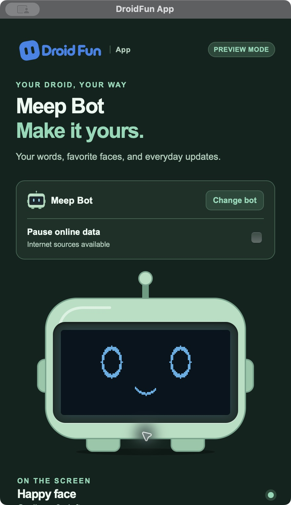
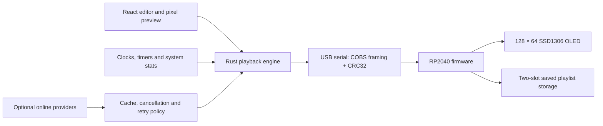

<div align="center">

# DroidFun

### A tiny robot. A complete desktop-to-device system.

Cross-platform desktop software and RP2040 firmware for a USB robot with a 128 × 64 OLED.

**Rust · Tauri 2 · React · TypeScript · C++ · RP2040**

[Download the app](https://github.com/alexwastaken/DroidFun/releases) · [Get started](#run-locally) · [Architecture](#how-it-works) · [Verification](#tested-and-still-to-test) · [MIT source](LICENSE)



*Native app previews from the recorded 0.4.1 release. The editor also works without a robot.*

</div>

## What it does

DroidFun turns a small USB display into a desk companion. Build a playlist of faces, stationary or scrolling custom text, uploaded images, clocks, Pomodoro timers, meeting countdowns, CPU/memory stats, weather, stock quotes, or account-allowance screens. Preview the exact pixels, choose how long each screen stays, and send the playlist to your bot.

**DroidFun App 0.10.0** is available from [Downloads](https://droidfun.io/downloads). It starts with a plug-in welcome, includes the website’s rotating 3D droid previews and proportional screen illustrations with optional enlargement, and recognizes a single factory-prepared Nimbus, Boo, Meep or Claw. Older droids can be recognized through a bounded model-only lookup after Workshop registration; offline or unknown boards ask once. Use the small arrows or droid menu at the top to switch between up to four plugged-in droids. Each keeps its own screens and display settings. Only the selected droid receives live app frames; the others show saved screens or their fallback face. A fifth waits for a slot, and older remembered profiles remain intact. Customer builds contain no database credentials or private inventory access. Factory firmware **1.3.2** and **1.3.2-mistake** are preserved; the separate customer recovery image remains **1.2.4**. See [identification and private inventory](docs/DROID_REGISTRY.md), [the customer and Workshop handoff](docs/ECOSYSTEM.md), and the [USB setup guide](docs/USB_SETUP.md).

Local candidate **0.10.3** corrects stale remembered droid models from verified factory identity and retains the quiet Mac menu-bar mode and USB repairs. It is not on public downloads while Apple Developer ID signing and notarization remain pending. [Claw recognition acceptance](docs/verification/0.10.3/README.md) · [Menu-bar checks](docs/verification/0.10.2/README.md) · [USB repairs](docs/verification/0.10.1/README.md).

- **Nimbus, Boo, Meep and Claw profiles** with matching controls, previews, and light/dark themes. Nimbus, Boo and Meep support everyday widgets; Claw focuses on Claude/Codex account allowance.
- **A real screen editor:** reorder widgets, set their timing, adjust text layout, borders and inversion, and preview the 128 × 64 result.
- **Desktop playback:** Show now, Pin, Pause, Next and Resume share one playback state; closing the controls leaves the tray app running.
- **Local operation:** text, uploaded images, faces, clocks, timers and system stats work without internet. Pause online data cancels network work while local screens and USB continue.
- **Plug in and connect:** prepared droids are recognized without a model-picker step. Connection shows installed software and the next useful action. Preview is available without hardware.
- **Protected firmware recovery:** supported Macs can service verified standard legacy firmware through 1.2.4 using direct USB with a board-ID check before writing. Factory, newer, custom and swapped-wiring firmware are protected from generic reinstalls. Unknown bootloaders and Windows/Linux firmware service go to support or private Workshop. Screen diagnostics are limited to compatible supported Mac recovery paths.
- **Customer troubleshooting:** Connection → Run diagnostics checks USB replies, reported screen health, display policy and source state. A temporary eight-second checkerboard checks visibility without installing firmware. Review and save a local report for support, with the droid ID and error codes; account details and screen contents are excluded. See [diagnostics and owner triage](docs/SUPPORT.md).
- **App updates:** Mac and Windows check quietly once per online session. Use Settings → App to check manually, download a signed update and explicitly restart to install it. Install the first updater-enabled release normally; Linux packages remain manual. See [app update releases](docs/APP_UPDATES.md).
- **Saved text, images and faces:** firmware 1.2.2 retains support for up to 30 stored screens for USB wall power, introduced in 1.2.0. Host storage/lifecycle tests pass; physical unplug-and-reboot acceptance remains open.
- **Optional online sources:** Open-Meteo weather, Yahoo Finance quotes, and existing Codex/Claude Code sign-ins. Allowance widgets show percentages, not token counts.

See [screen setup](docs/SCREENS.md), [USB setup and diagnostics](docs/USB_SETUP.md), [local widgets](LOCAL_WIDGETS.md), and [Linux USB setup](docs/LINUX_USB_ACCESS.md).

## How it works



The interesting work is at the boundaries:

| Engineering decision | What it protects |
| --- | --- |
| [Framed packets, CRC32, session IDs and sequence numbers](src-tauri/src/protocol.rs) | Rejects malformed or stale serial traffic and lets the decoder recover for the next packet. |
| [Bounded connection handling](src-tauri/src/connection.rs) | Reconnects to the selected device and separates transport acknowledgments from display health. |
| [Explicit USB setup](src-tauri/src/firmware_setup.rs) and [Mac ROM transport](src-tauri/src/picoboot.rs) | Checks the selected board, verifies direct USB writes, and waits for runtime identity before reconnecting. |
| [Cancellable provider requests](src-tauri/src/network.rs) | Stops work after a source, bot or online-data setting changes; shares cached responses and bounds retries. |
| [Version-aware settings storage](src-tauri/src/persistence.rs) | Writes through a temporary file, keeps a usable backup and preserves unknown future schemas. |
| [Checksummed, two-slot firmware storage](firmware/deskbot_firmware/standalone_storage.h) | Validates the whole upload before committing a saved playlist; an incomplete upload leaves the prior slot intact. |
| [Native packaging and smoke checks](docs/NATIVE_BUILDS.md) | Records installer payloads, architecture checks, launch results and remaining platform limits. |

The desktop renders the frames; the firmware validates them and drives the display. This keeps widget behavior independent of the USB packet format. No firmware flashing happens automatically.

## Run locally

Use **Node.js 22.12+ (24 recommended)**, Rust, and the [Tauri prerequisites for your OS](https://v2.tauri.app/start/prerequisites/). The native build workflows pin Rust 1.99.0. Codex and Claude Code are optional; they are only needed for their account integrations.

```sh
git clone https://github.com/alexwastaken/DroidFun.git
cd DroidFun
npm ci
npm run tauri -- dev
```

You can configure screens and use the preview without hardware. A physical bot uses an **RP2040-Zero + SSD1306 128 × 64 OLED**, with **SDA GPIO 4, SCL GPIO 5, address 0x3C or 0x3D**. See the [firmware builds](firmware/releases/README.md) and [in-app USB setup](docs/USB_SETUP.md) before connecting or flashing a board.

```sh
npm run check
npm run build
cargo test --manifest-path src-tauri/Cargo.toml
```

The [firmware host tests](firmware/tests/README.md) compile the production storage headers and full firmware sketch against in-memory hardware substitutes, with AddressSanitizer and UndefinedBehaviorSanitizer. They do not access or flash a device.

For installers, use the [native build guide](docs/NATIVE_BUILDS.md). Packaging runs on the target OS; publishing and website updates are separate manual steps.

The universal Mac USB helper and replaceable libusb library ship with their [source archives, notices and offline rebuild recipe](src-tauri/resources/picotool-macos-universal/README.md). The [firmware/helper source guide](docs/FIRMWARE_SOURCE.md) explains rebuilding those components without flashing a device.

## Tested and still to test

The [0.10.0 droid-switching release](docs/verification/0.10.0/README.md) passed 148 native tests on Mac and 142 on each Windows architecture and Linux, with zero failures. All 66 browser/image checks, 59 storefront tests and six updater-tool tests passed. Exact-source package hashes, universal Mac load commands/signature and Mac/Windows updater signatures were verified. The installed Mac upgraded from 0.9.0 to 0.10.0, restarted automatically, preserved settings byte for byte, displayed the top switcher and reported up to date on a fresh check. All six public downloads matched expected files. Four physical USB droids were not available; hardware switching and wall-power playback acceptance remain separate.

The [0.9.0 diagnostics release](docs/verification/0.9.0/README.md) passed 143 native tests on Mac and 137 on each Windows architecture and Linux, with zero failures. All 56 browser/image checks and 59 storefront tests passed; exact-source package hashes and updater signatures were verified. The installed Mac upgraded from 0.8.0 to 0.9.0, restarted automatically, preserved settings byte for byte, produced the correct no-device result, saved a reviewed owner-only support report and opened the public help page in Chrome. All six website downloads matched their expected files. Physical pattern visibility and firmware-service acceptance remain separate hardware checks.

The [0.8.0 custom screen release](docs/verification/0.8.0/README.md) passed 136 native tests on Mac and 130 on each Windows architecture and Linux, with zero failures. All 46 browser/image checks and 59 storefront tests passed; installer hashes and updater signatures passed independent verification. A real installed Mac 0.7.1 → 0.8.0 update restarted automatically and preserved settings byte for byte. All six website downloads matched their hashes. Images convert locally; Claw retains usage screens. Physical OLED transfer and wall-power acceptance remain open.

The [0.7.1 visual correction](docs/verification/0.7.1/README.md) passed 131 native tests on Mac and 125 on each Windows architecture and Linux, with zero failures; installer checks, package hashes and updater signatures passed. All 32 browser scenarios passed, including four screen previews at 360/500 px and exact pixel preservation in the enlarged view. A real installed Mac 0.7.0 → 0.7.1 update restarted automatically, preserved settings and displayed the corrected proportions. All five website installers were downloaded and hash-checked; Guide 2.4 remains unchanged. Firmware is unchanged.

The [0.7.0 release](https://github.com/alexwastaken/DroidFun/releases/tag/v0.7.0), built from `b6d347d1f977db709ff4379af3294b03f912e5d4`, passed **131 native tests on Mac** and **125 each on Windows x64, Windows ARM64 and Linux x86_64**, with zero failures. [Mac CI](https://github.com/alexwastaken/DroidFun/actions/runs/40731707194) and [Windows/Linux CI](https://github.com/alexwastaken/DroidFun/actions/runs/40732069700) passed packaging checks. The customer UI passed **24 browser fixture scenarios**, including all four rendered models, reduced motion and WebGL fallback. The website passed **58 tests**, including nine registry security tests. All five public installers and Guide 2.4 matched their recorded download hashes. See [0.7.0 verification](docs/verification/0.7.0/README.md).

The installed Mac app completed a real **0.6.0 → 0.7.0** in-app update and automatic restart with unchanged settings. The owner paired private Workshop 0.3.0, and native authenticated inventory sync succeeded. No physical board was attached: USB recognition, readable-screen confirmation, power cycling and sleep/wake still require hardware acceptance. Mac notarization, Windows publisher signing and a real Windows in-app upgrade remain open.

The [0.6.0 release](https://github.com/alexwastaken/DroidFun/releases/tag/v0.6.0), built from `a5593ec9e68696e9e43dac1cb51c3c85361ed8f0`, passed **127 native tests on Mac** and **121 each on Windows x64, Windows ARM64 and Linux x86_64**, with zero failures. [Mac CI](https://github.com/alexwastaken/DroidFun/actions/runs/40626592307) and [Windows/Linux CI](https://github.com/alexwastaken/DroidFun/actions/runs/40626594859) also passed frontend and release checks. Windows/Linux installed-package smoke checks passed; Mac and Windows updater signatures were verified against the exact package bytes and version. The customer UI passed **18 browser fixture scenarios** covering recognition, legacy model selection, multiple droids, recovery restrictions, update progress/restart and offline behavior at narrow widths. The separate storefront passed **49 automated tests**, and all five public installers plus Guide 2.3 matched their recorded hashes after download.

A real Mac **0.5.5 → 0.6.0** upgrade completed through the in-app Check → Download → Restart controls. The process restarted automatically, the installed executable matched the verified universal archive, strict ad-hoc signature verification passed, and saved settings were unchanged. A follow-up manual check in Settings → App reported the app up to date. See [0.6.0 update acceptance](docs/APP_UPDATES.md#recorded-060-acceptance).

No physical droid was available for this 0.6.0 acceptance run. Real-device recognition, readable-screen confirmation, sustained USB operation, unplug/power-cycle behavior, saved screens on wall power and sleep/wake behavior remain unverified. Browser fixtures and package checks do not replace those physical checks. Mac packages remain ad-hoc signed without Developer ID notarization; Windows installers lack platform code signing. Windows in-app upgrade acceptance remains separate from installer smoke checks.

The repository keeps [versioned release evidence](docs/verification/0.4.1/README.md), not just screenshots. Recorded 0.4.1 results include 61 passing native tests on macOS and 64 on each Windows architecture and Linux. Those are release records, not a claim that every platform was rerun for this public-source update.

For the October 21, 2026 publication review, TypeScript checking, the frontend production build, and both firmware host-test executables passed. Native Rust tests and hardware acceptance were not rerun; see the [review record](docs/verification/publication-2026-10-21.json).

The final 0.4.2 builds passed for application commit `701a261bc26a66705b016cc85473a1cabf71b25a`: [Mac CI](https://github.com/alexwastaken/DroidFun/actions/runs/40215307155) recorded **97 passing native tests**, and [Windows x64, Windows ARM64 and Linux x86_64 CI](https://github.com/alexwastaken/DroidFun/actions/runs/40215309478) recorded **91 each**, with zero failures and one intentionally ignored live-account test per platform. Frontend and release-tooling checks passed, as did Windows/Linux installed-package smoke checks. The universal Mac package passed architecture and ad-hoc signature checks; Mac and Windows updater signatures were verified against the exact version and package bytes.

Firmware 1.2.2 compiles, and all four firmware host-test executables pass with AddressSanitizer and UndefinedBehaviorSanitizer. Coverage checks malformed-packet bounds, recovery into the next valid frame, identity preservation, the default face on a fresh board, and USB-operation cancellation. The helper's two architecture slices and macOS 13 minimum load commands were inspected; its version/help ran on Apple Silicon. Six updater release-tooling tests cover package/signature tampering, signed versions and exact published assets.

An actual upgrade of a writable, user-owned Mac test copy from **0.4.2-rc.1 to the public 0.4.2 release** completed through Settings → App → Check → Download → Restart. The app restarted automatically, its installed executable matched the published universal Mac executable, strict ad-hoc signature verification passed, and the settings file's SHA-256 was unchanged. A subsequent update check reported the app up to date. The board was absent, so this run did not verify physical USB operation after the app upgrade. See the [app update acceptance record](docs/APP_UPDATES.md#recorded-042-acceptance).

On October 25, a second Meep received the standalone display test through the app and its owner confirmed the checkerboard was visible. The app restored normal firmware 1.2.1, and the owner then confirmed its happy face. The rebuilt app then updated the same Meep to 1.2.2 with the case closed, verified its returning identity and OLED-ready handshake, and the owner confirmed a readable physical face or usage screen. USB removal/re-enumeration remains unresolved: a later 90-second passive observation with DroidFun closed and no DroidFun process recorded 46 valid samples, five USB registry IDs, and the board absent after 24 seconds. This shows that an active app is not required for the observed disappearance; it does not establish the cause. The [USB acceptance history](docs/USB_SETUP.md) distinguishes this working-screen unit from an earlier board whose OLED did not respond.

Current limits are explicit: sustained USB stability and physical USB operation after the desktop upgrade remain unverified; physical Save to bot / wall-power reboot validation is pending; macOS packages use ad-hoc signing without Developer ID notarization; Windows installers lack platform code signing; Intel Mac, macOS 13 and Fedora runtime checks remain open. Windows in-app upgrade acceptance also remains separate from its successful installer smoke checks and updater-signature verification. A consumer unit still needs a physical screen and power-cycle check before assembly acceptance. The detailed [acceptance record](SPEC_COMPLETION.md) and [reliability notes](RELIABILITY_TESTS.md) preserve the other release gates.

## Project map

| Directory | Responsibility |
| --- | --- |
| [`src/`](src/) | React controls, bot previews, screen editing and themes |
| [`src-tauri/src/`](src-tauri/src/) | Playback, rendering, serial protocol, providers and persistence |
| [`firmware/`](firmware/) | RP2040 firmware, diagnostic sketch, host tests and versioned UF2 builds |
| [`scripts/`](scripts/) | Packaging, installer checks and reliability fixtures |
| [`docs/`](docs/) | Setup guides, platform behavior and verification evidence |

## Privacy, dependencies and license

Account widgets are optional and use the user's existing local sign-in. DroidFun does not persist credentials, prompts or transcripts. The Claude allowance integration uses a client-compatibility endpoint rather than an advertised public API, so provider changes can affect it. See [provider implementation](PROVIDER_IMPLEMENTATION.md) and [recovery behavior](docs/CLAUDE_RECOVERY.md).

Original project source is available under the **[MIT License](LICENSE)**. Dependencies, fonts and the third-party components linked into the UF2 binaries retain their own terms. See [third-party notices](THIRD_PARTY_NOTICES.md) and [firmware source/rebuild instructions](docs/FIRMWARE_SOURCE.md). DroidFun is an independent project; references to services and hardware do not imply endorsement.

This repository contains the controller software and firmware. The separate enclosure/manufacturing collection and storefront are outside its scope.

## Simple setup and multiple droids (0.5.0)

The main connection flow uses plain setup states; board IDs, versions, paths and screen diagnostics are under Help. The first single detected droid auto-connects after model selection. Firmware installation remains explicit. Multiple droids can be named and remembered by USB identity; choose one to control at a time. Each profile saves its playlist, brightness, orientation, quiet hours and companion settings. App-wide online, appearance, startup and window preferences remain shared. Setup for multiple unprogrammed boards requires connecting one new board at a time. Existing USB firmware cannot reliably determine Nimbus/Boo/Meep/Claw model, so adding a droid asks once.

Settings schema 2 migrates existing screens and display settings without changing them and backs up schema 1 on first save. Older apps refuse the newer schema. Saves exceeding the existing 256 KiB limit leave the prior file intact. Profile isolation and migration tests pass; physical multi-droid switching remains pending. Bot firmware remains 1.2.3, and unexplained physical USB disappearance is not claimed fixed by this release.

Codex usage refreshes about every minute and Claude account usage about every five minutes while active and online; local Claude Code reports are checked every two seconds and reflect new reports written by Claude Code. Rate limits and source errors can delay refreshes. The display cycle and animation do not represent source polling frequency. Firmware 1.2.4 targets up to 30 FPS over the faster screen connection; older firmware and screens that need the slower connection keep their 5 FPS limit. Static pixels are sent only when they change.

Historical 0.5.1 lineup: Meep and Claw. Boo was temporarily retired from new setup; its archived artwork and legacy settings remain readable so updating does not erase existing files. The private owner programmer is distributed separately and is never included in customer downloads.

In 0.5.1, new setup offers Meep and Claw only. Mac and Windows receive the version through the signed app updater; Linux packages and the current one-page quick-start guide are on [Downloads](https://droidfun.io/downloads). The Mac in-app Check → Download → Restart upgrade to 0.5.1 preserved saved settings, installed the exact published universal executable, and reconnected to Claw with acknowledged live Codex frames. Native Windows and Linux package checks passed. A physical Mac sleep/wake cycle remains separate from these upgrade checks.
