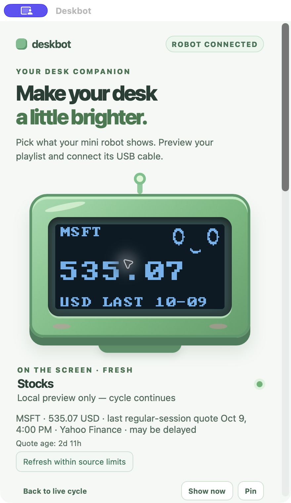

# DroidFun App

DroidFun App is a robot-themed tray companion for a USB RP2040-Zero and SSD1306 128×64 OLED. Clock, Pomodoro, meeting countdown, CPU, memory, weather, free stock quotes, Codex allowance, Claude account allowance and a friendly face are configurable in the app. The controls and cycle preview also work without hardware.

## App branding: 0.3.1

The app now uses the Droid Fun logo and blue theme from [droidfun.io](https://droidfun.io). See [branding and upgrade notes](docs/BRANDING.md).

## Published downloads: 0.3.0 (previous Deskbot branding)

- Download the Mac app as a [universal ZIP](https://github.com/greensky5656/DroidFun/releases/download/v0.3.0/Deskbot-0.3.0-macOS-universal.zip) or [disk image](https://github.com/greensky5656/DroidFun/releases/download/v0.3.0/Deskbot-0.3.0-macOS-universal.dmg) from the [development release](https://github.com/greensky5656/DroidFun/releases/tag/v0.3.0). Includes Apple Silicon and Intel executables; runtime tested on this Apple Silicon Mac. This is a local development build, without Developer ID signing or notarization.
- Windows installers: [x64](https://github.com/greensky5656/DroidFun/releases/download/v0.3.0/Deskbot-0.3.0-Windows-x64-setup.exe) or [ARM64](https://github.com/greensky5656/DroidFun/releases/download/v0.3.0/Deskbot-0.3.0-Windows-ARM64-setup.exe). Unsigned development packages; native tests and installation/window startup checks passed.
- Linux x86_64 packages: [DEB](https://github.com/greensky5656/DroidFun/releases/download/v0.3.0/Deskbot-0.3.0-Linux-x86_64.deb) or [RPM](https://github.com/greensky5656/DroidFun/releases/download/v0.3.0/Deskbot-0.3.0-Linux-x86_64.rpm). Native tests and DEB installation/window startup checks passed on Ubuntu 24.04. RPM metadata and executable architecture checked; Fedora runtime remains untested. [Build instructions and verification limits](docs/NATIVE_BUILDS.md).
- Connected replacement runs firmware **1.1.0**, SDA GPIO 4 / SCL GPIO 5, SSD1306 address 0x3C. The user confirmed the original live screens and five new local widget screens are readable, with the new bot movements visible.
- [Feature and acceptance record](SPEC_COMPLETION.md) separates working features from remaining platform and release gates. [Specification](IMPLEMENTATION_SPEC.md), [hardware research](HARDWARE_RESEARCH.md), [commissioning](firmware/COMMISSIONING.md), [provider evidence](PROVIDER_IMPLEMENTATION.md).



## Controls

- Add independent weather cities, stock symbols and usage windows. Enable/disable, reorder by dragging or arrow buttons, and choose each duration.
- Add clocks with local/named timezones, 12/24-hour time, seconds and date; Pomodoro timers with editable focus/break lengths and Start/Pause/Reset/Skip; meeting titles/date/time/duration; CPU sampling/history; and memory used/available, units and sampling. [Local widget guide](LOCAL_WIDGETS.md).
- Select a row for local preview. **Show now** displays it for one dwell and restores the cycle; **Pin** holds it; Pause, Next and Resume follow the saved playback state. Closing controls leaves the robot cycling.
- Data widgets keep the original happy bot in their upper-right corner, enlarged from the same face bitmap, with quicker blinks, glances toward the information, Ahh/Ooo mouths and a gentle one-pixel movement. Its reserved corner does not overlap the figures. Display settings control animation energy, glances and mouth shapes, or disable the companion/animation. Reduced motion and Pause freeze animation.
- The full face has happy, neutral, sleepy and surprised expressions, blinking and speed controls.
- Weather has Fahrenheit/Celsius and current conditions or daily high/low layouts. Stocks optionally show a verified price change while retaining currency and quote date. Public Yahoo quotes need no account or API key and may be delayed.
- Codex and Claude display **remaining account allowance percentages**, not token counts. Claude includes desktop/web/Code usage through your existing Claude Code sign-in. An optional status-line source supports selected reports; existing commands are preserved.
- Settings include orientation, overnight quiet hours, a 15-minute wake override, system/light/dark appearance, opt-in start at login, and tray/window behavior.
- Review diagnostics before saving a local report. Export the included firmware with manual BOOT instructions. Reset only DroidFun App preferences with a backup; account sign-ins remain intact.
- Invalid or expired data is skipped. Requests are bounded, cancel when configuration changes, share cached results, honor retry limits, and persist only usable public weather/stock cards. Credentials, prompts and transcripts are not persisted by DroidFun App.

On macOS the tray is the menu bar. On Windows it is the notification area beside the clock. Linux uses a compatible status notifier/system tray; without one, controls remain available as a normal minimized window and through the application launcher.

## Development

Install Node.js 22+, Rust and [Tauri prerequisites](https://v2.tauri.app/start/prerequisites/). Ordinary users run the packaged app and need no development tools. Codex/Claude Code are optional dependencies for their account integrations.

```sh
npm ci
npm run tauri -- dev
npm run check
CARGO_TARGET_DIR="$HOME/.cache/deskbot/target" cargo test --manifest-path src-tauri/Cargo.toml
npm run release -- --target universal-apple-darwin
```

Native packaging runs only on the current OS: macOS app/DMG, Windows NSIS x64 or ARM64, Linux x86_64 DEB/RPM. `--signed` requires platform signing configuration. It does not dispatch hosted builds or publish artifacts. Dependency versions and lockfiles are pinned. [Manual GitHub builds](docs/NATIVE_BUILDS.md) use native Windows/Linux runners and upload checked Actions artifacts for review; they do not publish automatically. The launcher uses an internal-disk Cargo cache on this Mac and removes only AppleDouble metadata sidecars before parsing project configuration.

Windows/Linux physical robot and live-account behavior, GNOME/KDE tray interaction, Fedora RPM runtime, Intel Mac runtime, full installer lifecycle, accessibility at enlarged text sizes, signing/notarization, timed hardware recovery and the 24-hour soak remain release gates. Disable Start at login before manually removing the macOS/Linux app, and Quit DroidFun App first. No automatic updater is enabled.
