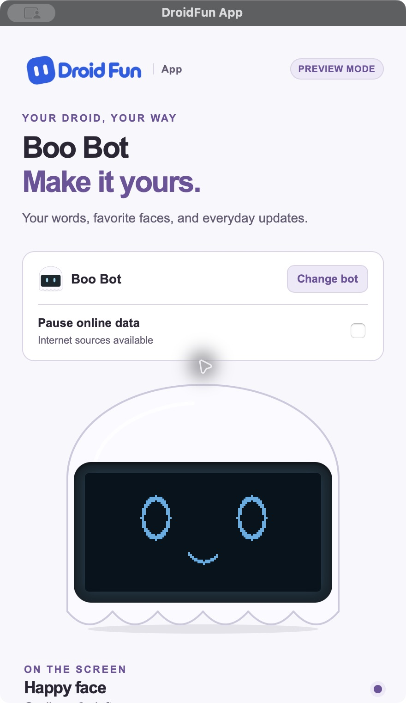
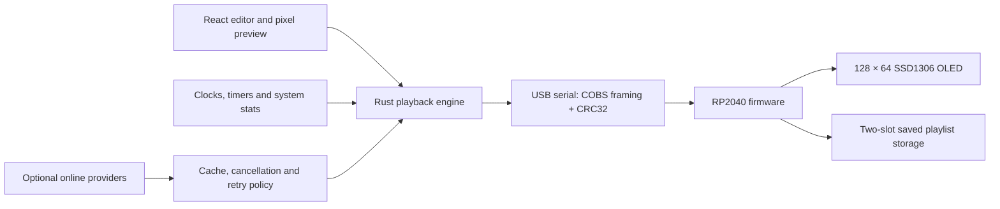

<div align="center">

# DroidFun

### A tiny robot. A complete desktop-to-device system.

Cross-platform desktop software and RP2040 firmware for a USB robot with a 128 × 64 OLED.

**Rust · Tauri 2 · React · TypeScript · C++ · RP2040**

[Download the app](https://github.com/alexwastaken/DroidFun/releases) · [Get started](#run-locally) · [Architecture](#how-it-works) · [Verification](#tested-and-still-to-test) · [MIT source](LICENSE)




*Native app previews from the recorded 0.4.1 release. The editor also works without a robot.*

</div>

## What it does

DroidFun turns a small USB display into a desk companion. Build a playlist of faces, custom text, clocks, Pomodoro timers, meeting countdowns, CPU/memory stats, weather, stock quotes, or account-allowance screens. Preview the exact pixels, choose how long each screen stays, and send the playlist to your bot.

The current release is **[DroidFun App 0.4.4](https://github.com/alexwastaken/DroidFun/releases/tag/v0.4.4)**, with embedded normal firmware **1.2.3**. See the [USB setup guide](docs/USB_SETUP.md) for the setup flow, recorded hardware observations and remaining acceptance checks.

- **Boo, Claw and Meep profiles** with matching controls, previews, and light/dark themes. Boo and Meep support everyday widgets; Claw focuses on Claude/Codex account allowance.
- **A real screen editor:** reorder widgets, set their timing, adjust text layout, borders and inversion, and preview the 128 × 64 result.
- **Desktop playback:** Show now, Pin, Pause, Next and Resume share one playback state; closing the controls leaves the tray app running.
- **Local operation:** text, faces, clocks, timers and system stats work without internet. Pause online data cancels network work while local screens and USB continue.
- **Setup with the case closed:** detect a new board, explicitly install its firmware, or update a running bot through the app. Mac builds include a universal direct USB helper for macOS 13+; Windows and Linux use the validated RP2040 setup drive.
- **Screen diagnostics on supported Macs:** install a temporary standalone test, read its identity-checked result, and restore normal firmware. The physical screen remains part of acceptance.
- **App updates:** on Mac and Windows, use Settings → App to check, download a signed update and explicitly restart to install it. Install the first updater-enabled release normally; Linux packages remain manual. See [app update releases](docs/APP_UPDATES.md).
- **Saved text and faces:** firmware 1.2.2 retains support for up to 30 stored screens for USB wall power, introduced in 1.2.0. Host storage/lifecycle tests pass; physical unplug-and-reboot acceptance remains open.
- **Optional online sources:** Open-Meteo weather, Yahoo Finance quotes, and existing Codex/Claude Code sign-ins. Allowance widgets show percentages, not token counts.

See [screen setup](docs/SCREENS.md), [USB setup and diagnostics](docs/USB_SETUP.md), [local widgets](LOCAL_WIDGETS.md), and [Linux USB setup](docs/LINUX_USB_ACCESS.md).

## How it works



The interesting work is at the boundaries:

| Engineering decision | What it protects |
| --- | --- |
| [Framed packets, CRC32, session IDs and sequence numbers](src-tauri/src/protocol.rs) | Rejects malformed or stale serial traffic and lets the decoder recover for the next packet. |
| [Bounded connection handling](src-tauri/src/connection.rs) | Reconnects to the selected device and separates transport acknowledgments from display health. |
| [Explicit USB setup](src-tauri/src/firmware_setup.rs) and [Mac ROM transport](src-tauri/src/picoboot.rs) | Checks the selected board, verifies direct USB writes, and waits for runtime identity before reconnecting. |
| [Cancellable provider requests](src-tauri/src/network.rs) | Stops work after a source, bot or online-data setting changes; shares cached responses and bounds retries. |
| [Version-aware settings storage](src-tauri/src/persistence.rs) | Writes through a temporary file, keeps a usable backup and preserves unknown future schemas. |
| [Checksummed, two-slot firmware storage](firmware/deskbot_firmware/standalone_storage.h) | Validates the whole upload before committing a saved playlist; an incomplete upload leaves the prior slot intact. |
| [Native packaging and smoke checks](docs/NATIVE_BUILDS.md) | Records installer payloads, architecture checks, launch results and remaining platform limits. |

The desktop renders the frames; the firmware validates them and drives the display. This keeps widget behavior independent of the USB packet format. No firmware flashing happens automatically.

## Run locally

Use **Node.js 22.12+ (24 recommended)**, Rust, and the [Tauri prerequisites for your OS](https://v2.tauri.app/start/prerequisites/). The native build workflows pin Rust 1.99.0. Codex and Claude Code are optional; they are only needed for their account integrations.

```sh
git clone https://github.com/alexwastaken/DroidFun.git
cd DroidFun
npm ci
npm run tauri -- dev
```

You can configure screens and use the preview without hardware. A physical bot uses an **RP2040-Zero + SSD1306 128 × 64 OLED**, with **SDA GPIO 4, SCL GPIO 5, address 0x3C or 0x3D**. See the [firmware builds](firmware/releases/README.md) and [in-app USB setup](docs/USB_SETUP.md) before connecting or flashing a board.

```sh
npm run check
npm run build
cargo test --manifest-path src-tauri/Cargo.toml
```

The [firmware host tests](firmware/tests/README.md) compile the production storage headers and full firmware sketch against in-memory hardware substitutes, with AddressSanitizer and UndefinedBehaviorSanitizer. They do not access or flash a device.

For installers, use the [native build guide](docs/NATIVE_BUILDS.md). Packaging runs on the target OS; publishing and website updates are separate manual steps.

The universal Mac USB helper and replaceable libusb library ship with their [source archives, notices and offline rebuild recipe](src-tauri/resources/picotool-macos-universal/README.md). The [firmware/helper source guide](docs/FIRMWARE_SOURCE.md) explains rebuilding those components without flashing a device.

## Tested and still to test

The repository keeps [versioned release evidence](docs/verification/0.4.1/README.md), not just screenshots. Recorded 0.4.1 results include 61 passing native tests on macOS and 64 on each Windows architecture and Linux. Those are release records, not a claim that every platform was rerun for this public-source update.

For the October 21, 2026 publication review, TypeScript checking, the frontend production build, and both firmware host-test executables passed. Native Rust tests and hardware acceptance were not rerun; see the [review record](docs/verification/publication-2026-10-21.json).

The final 0.4.2 builds passed for application commit `701a261bc26a66705b016cc85473a1cabf71b25a`: [Mac CI](https://github.com/alexwastaken/DroidFun/actions/runs/40215307155) recorded **97 passing native tests**, and [Windows x64, Windows ARM64 and Linux x86_64 CI](https://github.com/alexwastaken/DroidFun/actions/runs/40215309478) recorded **91 each**, with zero failures and one intentionally ignored live-account test per platform. Frontend and release-tooling checks passed, as did Windows/Linux installed-package smoke checks. The universal Mac package passed architecture and ad-hoc signature checks; Mac and Windows updater signatures were verified against the exact version and package bytes.

Firmware 1.2.2 compiles, and all four firmware host-test executables pass with AddressSanitizer and UndefinedBehaviorSanitizer. Coverage checks malformed-packet bounds, recovery into the next valid frame, identity preservation, the default face on a fresh board, and USB-operation cancellation. The helper's two architecture slices and macOS 13 minimum load commands were inspected; its version/help ran on Apple Silicon. Six updater release-tooling tests cover package/signature tampering, signed versions and exact published assets.

An actual upgrade of a writable, user-owned Mac test copy from **0.4.2-rc.1 to the public 0.4.2 release** completed through Settings → App → Check → Download → Restart. The app restarted automatically, its installed executable matched the published universal Mac executable, strict ad-hoc signature verification passed, and the settings file's SHA-256 was unchanged. A subsequent update check reported the app up to date. The board was absent, so this run did not verify physical USB operation after the app upgrade. See the [app update acceptance record](docs/APP_UPDATES.md#recorded-042-acceptance).

On October 25, a second Meep received the standalone display test through the app and its owner confirmed the checkerboard was visible. The app restored normal firmware 1.2.1, and the owner then confirmed its happy face. The rebuilt app then updated the same Meep to 1.2.2 with the case closed, verified its returning identity and OLED-ready handshake, and the owner confirmed a readable physical face or usage screen. USB removal/re-enumeration remains unresolved: a later 90-second passive observation with DroidFun closed and no DroidFun process recorded 46 valid samples, five USB registry IDs, and the board absent after 24 seconds. This shows that an active app is not required for the observed disappearance; it does not establish the cause. The [USB acceptance history](docs/USB_SETUP.md) distinguishes this working-screen unit from an earlier board whose OLED did not respond.

Current limits are explicit: sustained USB stability and physical USB operation after the desktop upgrade remain unverified; physical Save to bot / wall-power reboot validation is pending; macOS packages use ad-hoc signing without Developer ID notarization; Windows installers lack platform code signing; Intel Mac, macOS 13 and Fedora runtime checks remain open. Windows in-app upgrade acceptance also remains separate from its successful installer smoke checks and updater-signature verification. A consumer unit still needs a physical screen and power-cycle check before assembly acceptance. The detailed [acceptance record](SPEC_COMPLETION.md) and [reliability notes](RELIABILITY_TESTS.md) preserve the other release gates.

## Project map

| Directory | Responsibility |
| --- | --- |
| [`src/`](src/) | React controls, bot previews, screen editing and themes |
| [`src-tauri/src/`](src-tauri/src/) | Playback, rendering, serial protocol, providers and persistence |
| [`firmware/`](firmware/) | RP2040 firmware, diagnostic sketch, host tests and versioned UF2 builds |
| [`scripts/`](scripts/) | Packaging, installer checks and reliability fixtures |
| [`docs/`](docs/) | Setup guides, platform behavior and verification evidence |

## Privacy, dependencies and license

Account widgets are optional and use the user's existing local sign-in. DroidFun does not persist credentials, prompts or transcripts. The Claude allowance integration uses a client-compatibility endpoint rather than an advertised public API, so provider changes can affect it. See [provider implementation](PROVIDER_IMPLEMENTATION.md) and [recovery behavior](docs/CLAUDE_RECOVERY.md).

Original project source is available under the **[MIT License](LICENSE)**. Dependencies, fonts and the third-party components linked into the UF2 binaries retain their own terms. See [third-party notices](THIRD_PARTY_NOTICES.md) and [firmware source/rebuild instructions](docs/FIRMWARE_SOURCE.md). DroidFun is an independent project; references to services and hardware do not imply endorsement.

This repository contains the controller software and firmware. The separate enclosure/manufacturing collection and storefront are outside its scope.
