# Widgets the robot could grow into

Thirty additional ideas for the 128×64 OLED. Each keeps the same smiling, blinking bot in the reserved corner. The Mac/Windows/Linux app supplies data and renders the frame; the RP2040 does not need internet access or extra hardware for these concepts.

**Now implemented:** clock (#1), Pomodoro (#3), manual meeting countdown (#4), CPU (#15) and memory (#16). Their settings and live behavior are in [LOCAL_WIDGETS.md](LOCAL_WIDGETS.md). The remaining entries are proposals. Local features can work without an account or API key. Connected features depend on an available data source, its permissions and its terms; free access is not assumed.

| # | Widget | What appears on the robot | Data/setup |
|---|---|---|---|
| 1 | Desk clock | Large time, date and weekday | Local |
| 2 | World clocks | Cycle through selected cities' times | Local time zones |
| 3 | Pomodoro | Focus/break label and time remaining | Local timer |
| 4 | Meeting countdown | Time until the next meeting | Calendar connection or manual entry |
| 5 | Event countdown | Days until a trip, birthday or deadline | Local |
| 6 | Stopwatch | Elapsed time and lap count | Local |
| 7 | Alarm | Next alarm and a visible reminder | Local; no sound from the OLED |
| 8 | Stretch reminder | Friendly eyes and “MOVE A LITTLE” | Local schedule |
| 9 | Water reminder | Next drink reminder and daily check-ins | Local schedule |
| 10 | Screen break | “LOOK AWAY” and a short countdown | Local timer |
| 11 | Tiny to-do list | One task at a time, with completion count | Local list; optional task service |
| 12 | Habit streak | Today's checklist and current streak | Local |
| 13 | Daily goal | Progress toward a user-entered target | Local |
| 14 | Custom note | A rotating message or encouragement | Local |
| 15 | Computer CPU | Utilization and a tiny history graph | Host computer |
| 16 | Computer memory | RAM used/available | Host computer |
| 17 | Disk space | Selected drive's free space | Host computer |
| 18 | Laptop battery | Charge, charging state and low-battery face | Host computer, when available |
| 19 | Network activity | Upload/download rate and graph | Host computer |
| 20 | Connection health | Online/offline status and last check | Host computer; a chosen probe |
| 21 | Download progress | Percentage, remaining bytes and time | Supported download source |
| 22 | Git status | Branch and number of pending changes | Selected local repository |
| 23 | Build/test status | Running, passed or failed build | Local job or connected CI service |
| 24 | Service health | Selected app/container up/down state | Local service or chosen endpoint |
| 25 | Now playing | Track title and playback progress | Supported media app |
| 26 | Rain outlook | Chance of rain and next forecast period | Weather provider |
| 27 | Air quality | AQI number and category | Air-quality provider |
| 28 | UV reminder | UV level and a short outdoor reminder | Weather provider |
| 29 | Sunrise/sunset | Next sunrise or sunset countdown | Location and date |
| 30 | Inbox count | Unread count with a privacy-friendly icon | Optional mail account connection |

## Suggested first batch

Start with **clock, Pomodoro, meeting/event countdown, break reminder and CPU/memory**. They suit a tiny screen and add useful everyday behavior. Local versions of these can be built first; meeting countdown can accept manual entries before calendar integration.

Shared controls should include duration, enable/disable, Preview, Show now, Pin, refresh limits where relevant, stale/unavailable handling, quiet hours, and the existing companion-face settings.

## Exact screen proposals

Each image below is an **illustrative layout with fictional sample values**, not a live reading. The five implemented widgets are noted above; these images remain design examples. The screen is exactly **128×64 monochrome pixels**, shown at 4× nearest-neighbor scale for readability. The companion uses the app’s original happy-face bitmap at the existing corner size; in the eventual widget it would smile/blink using the shared animation setting.

Header and context occupy the left of the top 26 rows. The same bot remains at the upper right. Main content starts at row 28; detail/progress/history uses the space below it, and the footer starts at row 55. There is no scrolling or hidden text in these samples. Long user-entered titles/messages would be shortened or split into additional cards at implementation time.

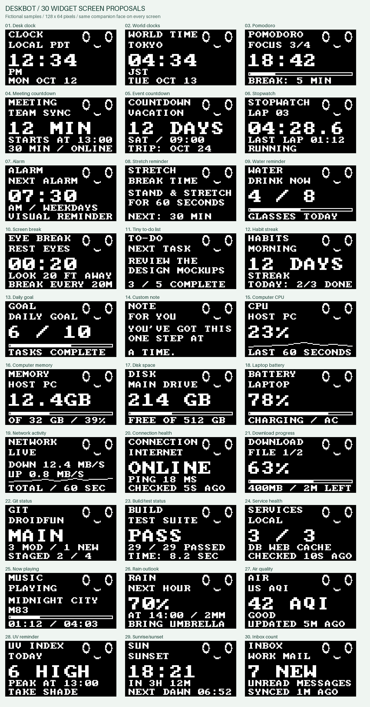

### 1. Desk clock

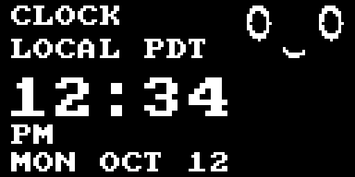

**Exact text:** `CLOCK` · `LOCAL PDT` · `12:34` · `PM` · `MON OCT 12`.

[Original 128×64 PNG](docs/images/widget-ideas/01-desk-clock-128x64.png)

### 2. World clocks

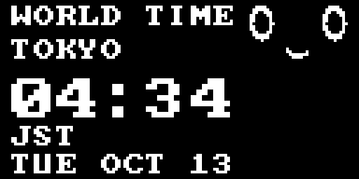

**Exact text:** `WORLD TIME` · `TOKYO` · `04:34` · `JST` · `TUE OCT 13`.

[Original 128×64 PNG](docs/images/widget-ideas/02-world-clocks-128x64.png)

### 3. Pomodoro

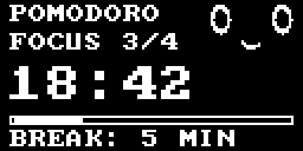

**Exact text:** `POMODORO` · `FOCUS 3/4` · `18:42` · `BREAK: 5 MIN`.

**Graphic:** outlined progress bar, 25.2% filled (focus interval elapsed).

[Original 128×64 PNG](docs/images/widget-ideas/03-pomodoro-128x64.png)

### 4. Meeting countdown

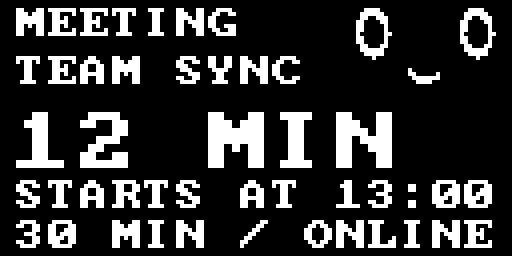

**Exact text:** `MEETING` · `TEAM SYNC` · `12 MIN` · `STARTS AT 13:00` · `30 MIN / ONLINE`.

[Original 128×64 PNG](docs/images/widget-ideas/04-meeting-countdown-128x64.png)

### 5. Event countdown

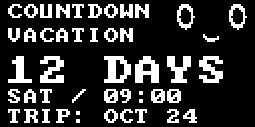

**Exact text:** `COUNTDOWN` · `VACATION` · `12 DAYS` · `SAT / 09:00` · `TRIP: OCT 24`.

[Original 128×64 PNG](docs/images/widget-ideas/05-event-countdown-128x64.png)

### 6. Stopwatch

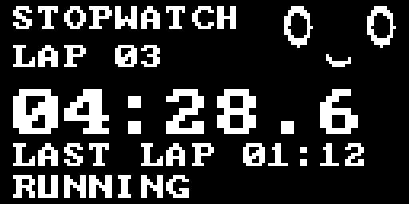

**Exact text:** `STOPWATCH` · `LAP 03` · `04:28.6` · `LAST LAP 01:12` · `RUNNING`.

[Original 128×64 PNG](docs/images/widget-ideas/06-stopwatch-128x64.png)

### 7. Alarm

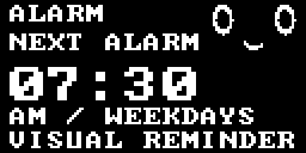

**Exact text:** `ALARM` · `NEXT ALARM` · `07:30` · `AM / WEEKDAYS` · `VISUAL REMINDER`.

[Original 128×64 PNG](docs/images/widget-ideas/07-alarm-128x64.png)

### 8. Stretch reminder

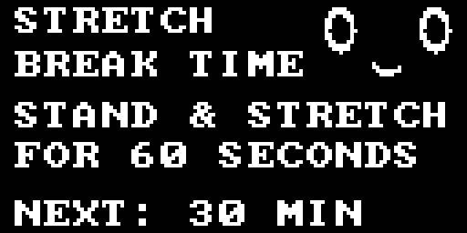

**Exact text:** `STRETCH` · `BREAK TIME` · `STAND & STRETCH` · `FOR 60 SECONDS` · `NEXT: 30 MIN`.

[Original 128×64 PNG](docs/images/widget-ideas/08-stretch-reminder-128x64.png)

### 9. Water reminder

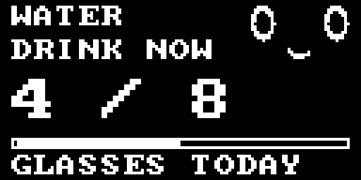

**Exact text:** `WATER` · `DRINK NOW` · `4 / 8` · `GLASSES TODAY`.

**Graphic:** outlined progress bar, 50.0% filled (completed / total or capacity).

[Original 128×64 PNG](docs/images/widget-ideas/09-water-reminder-128x64.png)

### 10. Screen break

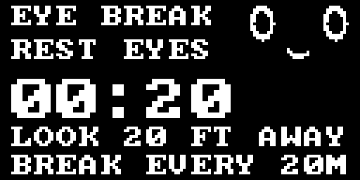

**Exact text:** `EYE BREAK` · `REST EYES` · `00:20` · `LOOK 20 FT AWAY` · `BREAK EVERY 20M`.

[Original 128×64 PNG](docs/images/widget-ideas/10-screen-break-128x64.png)

### 11. Tiny to-do list

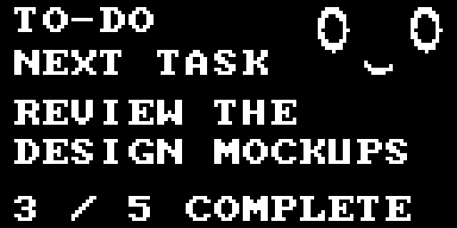

**Exact text:** `TO-DO` · `NEXT TASK` · `REVIEW THE` · `DESIGN MOCKUPS` · `3 / 5 COMPLETE`.

[Original 128×64 PNG](docs/images/widget-ideas/11-tiny-to-do-list-128x64.png)

### 12. Habit streak

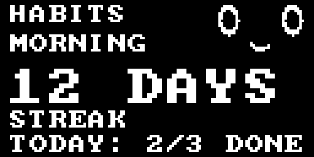

**Exact text:** `HABITS` · `MORNING` · `12 DAYS` · `STREAK` · `TODAY: 2/3 DONE`.

[Original 128×64 PNG](docs/images/widget-ideas/12-habit-streak-128x64.png)

### 13. Daily goal

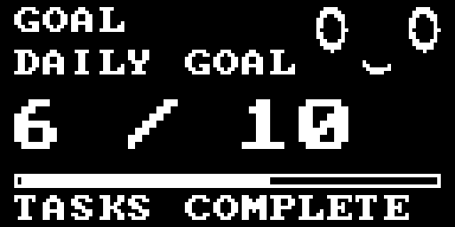

**Exact text:** `GOAL` · `DAILY GOAL` · `6 / 10` · `TASKS COMPLETE`.

**Graphic:** outlined progress bar, 60.0% filled (completed / total or capacity).

[Original 128×64 PNG](docs/images/widget-ideas/13-daily-goal-128x64.png)

### 14. Custom note

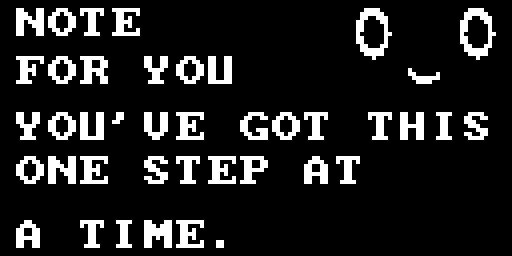

**Exact text:** `NOTE` · `FOR YOU` · `YOU'VE GOT THIS` · `ONE STEP AT` · `A TIME.`.

[Original 128×64 PNG](docs/images/widget-ideas/14-custom-note-128x64.png)

### 15. Computer CPU

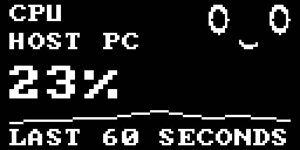

**Exact text:** `CPU` · `HOST PC` · `23%` · `LAST 60 SECONDS`.

**Graphic:** 60-second sparkline (CPU load, fixed 0–100% scale).

[Original 128×64 PNG](docs/images/widget-ideas/15-computer-cpu-128x64.png)

### 16. Computer memory

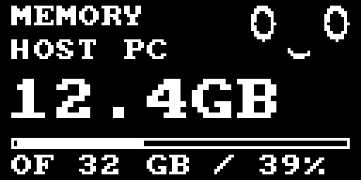

**Exact text:** `MEMORY` · `HOST PC` · `12.4GB` · `OF 32 GB / 39%`.

**Graphic:** outlined progress bar, 38.8% filled (completed / total or capacity).

[Original 128×64 PNG](docs/images/widget-ideas/16-computer-memory-128x64.png)

### 17. Disk space

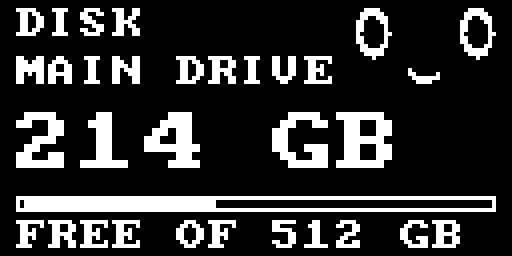

**Exact text:** `DISK` · `MAIN DRIVE` · `214 GB` · `FREE OF 512 GB`.

**Graphic:** outlined progress bar, 41.8% filled (free drive space).

[Original 128×64 PNG](docs/images/widget-ideas/17-disk-space-128x64.png)

### 18. Laptop battery

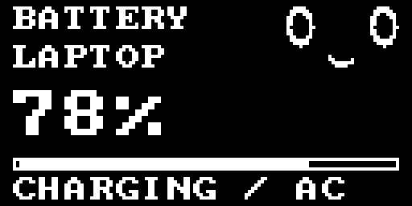

**Exact text:** `BATTERY` · `LAPTOP` · `78%` · `CHARGING / AC`.

**Graphic:** outlined progress bar, 78.0% filled (completed / total or capacity).

[Original 128×64 PNG](docs/images/widget-ideas/18-laptop-battery-128x64.png)

### 19. Network activity

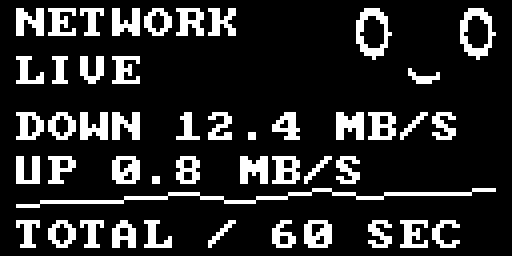

**Exact text:** `NETWORK` · `LIVE` · `DOWN 12.4 MB/S` · `UP 0.8 MB/S` · `TOTAL / 60 SEC`.

**Graphic:** 60-second sparkline (combined upload/download rate, scale to the displayed history).

[Original 128×64 PNG](docs/images/widget-ideas/19-network-activity-128x64.png)

### 20. Connection health

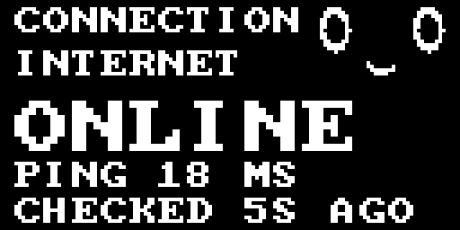

**Exact text:** `CONNECTION` · `INTERNET` · `ONLINE` · `PING 18 MS` · `CHECKED 5S AGO`.

[Original 128×64 PNG](docs/images/widget-ideas/20-connection-health-128x64.png)

### 21. Download progress

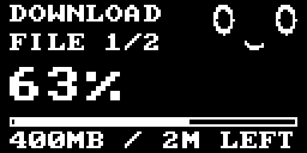

**Exact text:** `DOWNLOAD` · `FILE 1/2` · `63%` · `400MB / 2M LEFT`.

**Graphic:** outlined progress bar, 63.0% filled (completed / total or capacity).

[Original 128×64 PNG](docs/images/widget-ideas/21-download-progress-128x64.png)

### 22. Git status

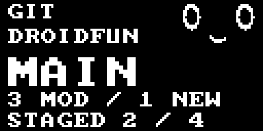

**Exact text:** `GIT` · `DROIDFUN` · `MAIN` · `3 MOD / 1 NEW` · `STAGED 2 / 4`.

[Original 128×64 PNG](docs/images/widget-ideas/22-git-status-128x64.png)

### 23. Build/test status

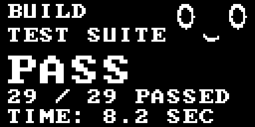

**Exact text:** `BUILD` · `TEST SUITE` · `PASS` · `29 / 29 PASSED` · `TIME: 8.2 SEC`.

[Original 128×64 PNG](docs/images/widget-ideas/23-build-test-status-128x64.png)

### 24. Service health

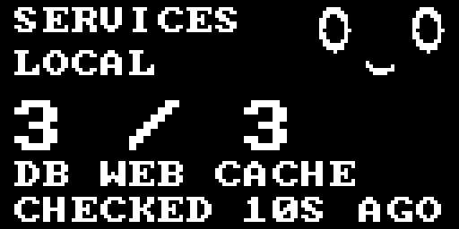

**Exact text:** `SERVICES` · `LOCAL` · `3 / 3` · `DB WEB CACHE` · `CHECKED 10S AGO`.

[Original 128×64 PNG](docs/images/widget-ideas/24-service-health-128x64.png)

### 25. Now playing

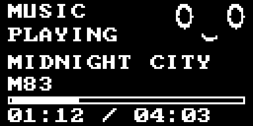

**Exact text:** `MUSIC` · `PLAYING` · `MIDNIGHT CITY` · `M83` · `01:12 / 04:03`.

**Graphic:** outlined progress bar, 29.6% filled (playback elapsed).

[Original 128×64 PNG](docs/images/widget-ideas/25-now-playing-128x64.png)

### 26. Rain outlook

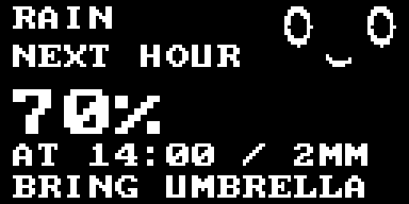

**Exact text:** `RAIN` · `NEXT HOUR` · `70%` · `AT 14:00 / 2MM` · `BRING UMBRELLA`.

[Original 128×64 PNG](docs/images/widget-ideas/26-rain-outlook-128x64.png)

### 27. Air quality

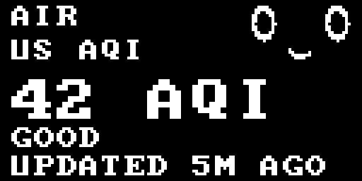

**Exact text:** `AIR` · `US AQI` · `42 AQI` · `GOOD` · `UPDATED 5M AGO`.

[Original 128×64 PNG](docs/images/widget-ideas/27-air-quality-128x64.png)

### 28. UV reminder

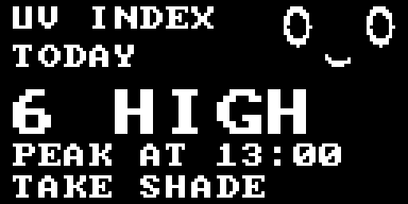

**Exact text:** `UV INDEX` · `TODAY` · `6 HIGH` · `PEAK AT 13:00` · `TAKE SHADE`.

[Original 128×64 PNG](docs/images/widget-ideas/28-uv-reminder-128x64.png)

### 29. Sunrise/sunset

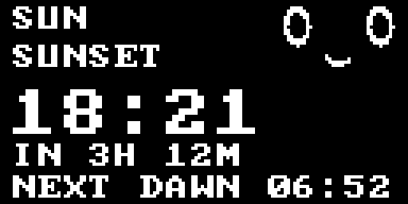

**Exact text:** `SUN` · `SUNSET` · `18:21` · `IN 3H 12M` · `NEXT DAWN 06:52`.

[Original 128×64 PNG](docs/images/widget-ideas/29-sunrise-sunset-128x64.png)

### 30. Inbox count

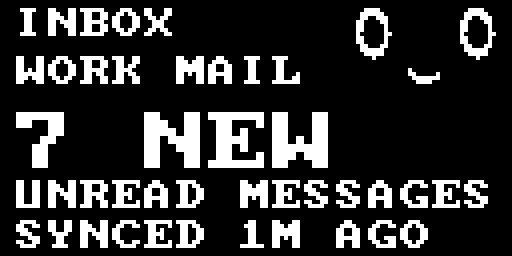

**Exact text:** `INBOX` · `WORK MAIL` · `7 NEW` · `UNREAD MESSAGES` · `SYNCED 1M AGO`.

[Original 128×64 PNG](docs/images/widget-ideas/30-inbox-count-128x64.png)
