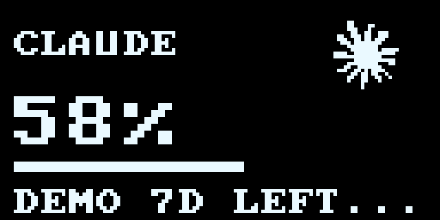

# Claude OLED mark

`claude-mark-source.png` is the monochrome tray mark from the installed official Claude desktop app (`Contents/Resources/TrayIconTemplate@3x.png`). Its 50 x 50 visible alpha bounds are sampled at 20 x 20, with a two-pixel margin inside the 24 x 24 OLED bitmap, using alpha threshold 128.

Claude uses the same safe logo placement, two-pixel downward bob, stationary title at y=9, and motion controls as Codex. It replaces the small face only on Claude usage screens. Usage data and account refresh behavior are unchanged.

