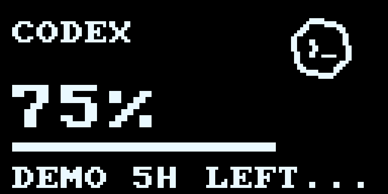

# Codex OLED mark

The source vector is the Codex mark from the installed official Codex app, `webview/assets/codex_new-f14177b03534.svg`. It identifies Codex account usage; it is not DroidFun branding.

The 24 x 24 one-bit mark rests at (94, 4), leaving six clear pixel rows above the visible shape. It bobs downward by up to two pixels, then returns, so it never rises behind the housing lip. The title is at y=9 in Classic and Minimal layouts, two pixels below the previous Codex header. Usage values, bar and footer stay fixed. Reduced motion, animation off and pause restore the resting frame. Speed follows the existing animation speed setting.

The development-only `device_smoke --usage-assets` command exports both logos' production frames without opening USB. `--codex-assets` remains an alias. The GIF uses sample usage and the default Lively animation speed.
