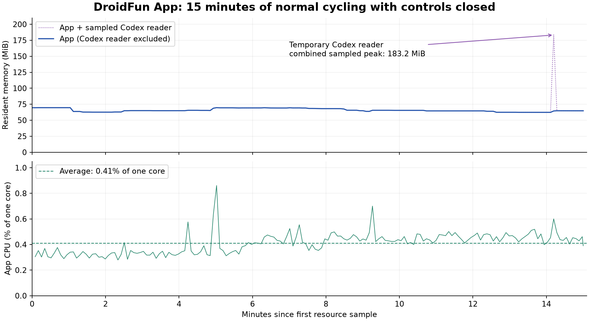

# Claude recovery and background resource verification

October 13, 2026. The updated ARM64 Mac app is installed at `/Users/hansparsons/Applications/DroidFun App.app`. Saved settings were retained; the connected robot uses its existing firmware. This local build has not replaced the published release packages.

## Claude behavior

The allowance reader now distinguishes a window reset from expired authentication. Explicit zero usage with no active reset can show unused allowance. Nonzero usage with an absent/elapsed reset shows a reset-pending status without inventing a remaining percentage. Missing or malformed data remains unavailable. Known window expiry can bring the next poll forward.

Expired access tokens use the existing trusted, app-owned installed-client renewal helper on Mac/Linux. HTTP 401 also rechecks for a rotated token, or attempts bounded renewal when the server rejects a token that still appears locally valid. The request is retried once. Failed renewal and persistent rejection remain explicit authentication states. The helper sends no model prompt, observes a twenty-second deadline and cleans up its session. Unrefreshable/revoked logins still require sign-in; Windows retains its manual reconnect path.

**39 Rust behavior tests passed**, plus frontend checking/building and a local ARM64 app build with its ad-hoc signature verified. Controlled recovery tests used isolated fixture credentials and a local HTTP server: expired credentials → owned helper → renewed token → valid card; server rejection → renewal → one retry; token rotation → one retry; explicit failure and helper timeout/cleanup. These tests did not alter the user's credentials.

The fixed app fetched valid live Claude cards and returned Claude to the robot's cycle. A separate pre-change diagnostic had already found active windows again, so upstream recovery is not attributed to this patch.

**Natural automatic renewal was verified later on October 13** in the green-theme rebuild with the unchanged Claude backend. The app recorded expiry/helper initiation at 7:20:12 PM Pacific and successful credential renewal at 7:20:14 PM. Subsequent newly fetched valid active cards and a Claude cycle were confirmed. Exact first-new-card latency and uninterrupted availability were not measured; integer event timing is not exact helper runtime. [Detailed evidence and limits](../CLAUDE_RECOVERY.md#natural-renewal-verified--october-13-2026). The dedicated heartbeat is now paused; the original full-day monitor remains paused.

## Controls-closed test

The app launched in the background using the user's normal nine-widget animated playlist. The observer started approximately 51 seconds after app launch; startup transients are outside this resource interval. Controls were absent throughout. This is an animated background test, distinct from the earlier pinned static face and twelve-hour open-window observation.

| Measurement | Result |
| --- | ---: |
| Resource interval | 900.20 seconds — 15 minutes |
| Healthy observations | 175 / 175 |
| Flagged gaps / missing measurements | 0 / 0 |
| Typical app memory, median | **65.05 MiB** |
| App memory peak / final | **69.66 / 64.78 MiB** |
| Settled early / last five-minute median | **65.41 / 64.61 MiB** |
| Average app CPU | **0.410% of one logical core** |
| CPU 95th percentile / largest measured interval | **0.505% / 0.861%** |
| Maximum pending requests | 1 |
| Validated display-frame ACKs | 1,744 |

Memory showed no upward resident trend during this interval. Fifteen minutes cannot rule out a slow leak, compressed/retained allocations or later growth. CPU includes test logging and the app's included helpers, but excludes the temporary Codex account-reader subtree, which is reported separately. The observer's own CPU is not app CPU.

### Temporary account-reader cost

One sample captured a **118.73 MiB Codex helper**, raising the combined sampled-owned-process peak to **183.23 MiB**. The 69.66 MiB app peak must not be presented as the peak including that reader. Short-lived helper peaks and their complete CPU cost can fall between five-second measurements. Summed resident memory can double count shared pages.

All eight live data kinds were fresh in all 175 observations. Claude had **four distinct fetch timestamps** and **19 cycle visits**. Every enabled kind appeared 19–20 times in the transition trace. Meeting countdown remained disabled and Pomodoro remained paused at its normal settings. There were no frame-counter resets, unexplained unhealthy observations or missing process measurements. Maximum sample interval was **5.25 seconds**; maximum completed telemetry age was **6.04 seconds**.

Frame ACKs establish transport; the user's prior physical readability review is separate. No fault injection, model prompts, credential manipulation or new full-day soak was used for this resource check.

## Cleanup and evidence

The exact resource collector finished, its scoped sleep prevention exited, and its LaunchAgent/plist were removed. The fixed app remains connected with controls closed and preferences unchanged. The later natural-renewal check has completed and logging has stopped. The normal app was restarted with preferences retained and controls closed. Mac currently detects neither the RP2040 nor a serial node, so the user has been asked to reconnect the robot; post-restart hardware recovery remains pending.

- [Detailed results, build/source hashes and evidence manifest](claude-background-2026-10-13.json)
- [PNG chart](claude-background-2026-10-13.png) · [SVG chart](claude-background-2026-10-13.svg)
- [Recovery implementation, fixtures and primary sources](../CLAUDE_RECOVERY.md)
- Private collector evidence: `/Users/hansparsons/.cache/deskbot/reliability/2026-10-13-claude-closed-final-15m`
- Private build, frozen in-range transitions and monitor manifest: `/Users/hansparsons/.cache/deskbot/verification/2026-10-13-claude-recovery-final`

The preliminary candidate's short resource observation remains separate and was not added to the final fifteen-minute interval. Earlier partial reliability runs retain their original verdicts and evidence. Natural expiry was verified in the later green-theme app instance. Full 24-hour qualification and the previously listed physical/platform gates remain separate.

## Green theme restored

The original accepted green stylesheet was restored on October 13 after the user reported the unexpected blue branding palette. The current DroidFun header layout is retained. The local app was rebuilt, signature-checked and replaced after graceful shutdown, retaining settings and Claude/backend source hashes. The robot reconnected ready and Claude remained fresh. Natural-renewal monitoring follows the new exact app identity with its original deadline. The resource results above remain evidence for the earlier fixed build; they were not relabeled as measurements of the frontend rebuild.
